# 概要设计

## 1 引言

### 1.1 编写目的

本文档明确设计理念、总体结构与关键机制，作为后续详细设计、实现与测试的共同基准。

本文档同时承担消歧职责。本项目的多项设计选择不同于同类智能体运行框架的常见做法，阅读时若按外部产品或既有惯例望文生义、过度解读，会得出与本文不符的结论。凡本文与其他资料、同类产品惯例不一致之处，以本文为准；本文未明确的内容，应视为尚未决定，不得由惯例推断。

### 1.2 项目背景

**会话前审查透明**

智能体运行框架的构建请求上下文的标准流程包含两个动作，先是发现并读取特定目录下文件，然后将声明内容写入系统提示词或作为工具声明。运行框架以纯文本的形式读取文件是安全的，在其中的声明被写入请求并发送到智能体以后，智能体将有权决定是否执行特定动作。

多数同类框架将这两个动作合并为一步，把发现到的声明全量、隐式地写入系统提示词或工具声明，恶意或被投毒的资源会在用户不知情的情况下进入智能体上下文，引导智能体进行破坏性任务。针对这一风险，本项目提出在「发现、读取文件」与「写入请求」两个动作之间增加显式确认环节。用户在会话开始前可审阅运行框架发现的声明，自行选择需要添加到请求的条目。

**会话后溯源透明**

智能体只能通过运行框架提供的工具操作用户设备，其一切行动都将在运行框架中留下痕迹。在溯源意外事件的过程中，运行框架的记录远比智能体充满幻觉与辩解的总结可靠。

### 1.3 文档内容范围

本项目设计并实现一个基于 TypeScript 的智能体运行框架（Harness）。框架把大语言模型供应商接口调用封装为工作循环，负责请求构建与返回解析、会话持久化、工具调用请求与响应等，降低智能体工作流程的使用门槛。

框架的核心设计理念为透明可控与模板化。软件以服务形式运行，不依赖客户端。

本文档覆盖：总体架构、模块划分与职责、关键机制、接口与数据、运行与非功能设计、构建与分发。

本文档不覆盖：函数级实现细节、测试用例、项目进度与分工。

### 1.4 设计理念

**透明可控**

- 系统提示词不隐式写入请求体，而是插入消息队列，用户可查看、修改、删除。
- 工具声明经显式选择后通过请求体中指定字段提供给智能体；技能声明经显式选择后写入系统提示词；未被选中的声明不进入请求。
- 持久化保存提示词输入、工具调用记录，作为事后溯源的事实依据。
- 保证用户对智能体工作的知情权，允许用户根据安全需求构建相应防护机制；不假想安全威胁并为其实现繁杂安全机制。

**模板化**

- 对用户总结的可复用工作流程，以项目模板的形式予以支持；初始化流程以声明式步骤或脚本表示，经用户确认后由服务层执行。

**服务化与客户端解耦**

- 软件以守护进程形式长驻，对外只暴露协议和 CLI 命令；客户端以扩展形式开发、分发，经协议连接守护进程。

**增量开发**

- 遵循 KISS 原则，按阶段推进增量开发，优先保证核心功能和创新点模块交付。

**一般性优先**

- 不针对特定模型优化，不预设复杂但不通用的工具，保证框架与智能体的交互具有一般性。

### 1.5 读者与阅读约定

读者为本项目的设计与开发人员。

- 术语以本项目约定为准，不套用同类产品的术语含义。
- 本文档描述设计意图与约束，不规定实现细节。

### 1.6 术语及其使用规范

#### 定义

- 智能体（Agent）：对大语言模型在特定任务中的身份声明。
- 智能体工作循环（Agent Loop）：在一次大语言模型供应商接口请求发出后，解析响应体中工具调用相关内容并根据工具结果生成、发送新请求体，直到响应体中无工具调用的循环工作过程。
- 智能体运行框架（Harness）：在特定主机上运行，为智能体工作提供支持的运行环境。
- 工作区（Workspace）：目录结构、特定文件内容符合用户工作流程需要的工作路径。
- 项目模板（Project Template）：在特定任务中，工作区目录结构、特定文件内容要求，及为满足该要求必需的初始化流程的表示。
- 会话（Session）：1. 存储在外存中，在智能体工作循环中发送的提示词和响应体中的大语言模型生成内容及其存储形式。又称为“冷会话”。2. 正在进行的智能体工作循环。又称为“热会话”。
- 上下文（Context）：工作循环中实际写入请求体的、输入大语言模型的文本内容。
- 日志（log）：运行框架运行过程中各模块运行状况的记录。
- 消息队列（Message Queue）：暂存用户待发送消息与控制条目的有序集合。
- 智能体消息（Agent Message）：直接写入请求体的会话消息。
- 控制消息（Control Message）：不直接写入请求体、负责指导上下文组装的消息。
- 回合（Turn）：从首次确认信号发出到本轮结束的一次智能体工作循环，可包含多个 step；热会话中的再次确认只追加 steer 条目，不开启新回合。
- 步骤（Step）：一次请求—响应。
- 包装器（Wrapper）：包装工具声明，在工具执行前后添加逻辑的扩展条目。
- 上下文来源（Context Source）：装配请求上下文时产出片段的扩展条目。
- 扩展（Extension）：以包或目录分发、向运行框架提供内容条目的单元。
- 扩展清单（Manifest）：扩展包内声明内容条目的清单。
- 扩展清点（Inventory）：运行框架已发现的扩展条目集合。
- 继续发送（Steer）：热会话进行中提交新的用户消息，由后续 step 装配。

#### 使用规范

- 绝对禁止混用“会话”与“日志”。“会话”面向用户，内容来自智能体工作循环。“日志”面向软件的开发与维护人员，内容来自软件源代码运行过程。
- 禁止混用“大语言模型”和“智能体”。仅在和外部依赖接口相关时使用“大语言模型”。

## 2 设计目标与约束

### 2.1 设计目标

**透明可控（核心目标）**

- 系统提示词、工具和技能声明插入用户消息队列，供用户增删查改，不隐式写入请求体，只有用户确认无误并发出确认信号后才随用户消息发送到智能体触发其工作循环。
- 采用树形结构只加式组织会话过程记录，作为事后溯源的事实依据。
- 保证用户在智能体工作循环全程具有充分知情权：进入工作前可检查、修改使用的提示词和声明集合，工作过程中可观察动态，工作结束后可根据会话记录溯源因果。

**模板化**

- 提供项目模板机制，管理用户自定义的提示词文件、外部软件配置文件等预设，以及由模板衍生的同类项目，以声明式步骤或脚本提供工作区初始化功能，可选地引用智能体技能。

**可扩展**

- 工具、包装器、技能、上下文来源、大语言模型供应商配置与客户端均以可拔插的扩展形式提供，软件核心层只定义相关标准与注册表。
- 扩展复用 Node 生态的包格式与分发机制。

**关注点分离与可测试**

- 核心层模块只含环境、传输无关的逻辑，可独立于文件系统、子进程与网络测试。
- 环境相关职责集中于服务层，便于替换与移植。

**服务化与客户端无关**

- 后端以守护进程形式长驻运行，提供基本的命令行命令供用户进行直接的简单交互，提供协议供客户端连接。
- 客户端不持有全局锁。后端通过必要的锁，保证多个客户端可同时参与到同一个智能体工作循环中。

**一般性**

- 不针对特定大语言模型及其供应商优化，优先实现高频使用的泛用工具，保证智能体与运行框架的交互具有一般性。

### 2.2 设计约束

**技术约束**

- 实现语言为 TypeScript，运行时为 Node，包管理器使用 Pnpm，模块系统为 ESM。
- 采用工作区多包组织，内部包通过工作区协议互相引用。
- 协议传输无关，可挂载多种传输。

**架构约束**

- 分层依赖方向固定为：客户端进程 → 协议 ← 服务层 → 核心层。
- 核心层不得依赖服务层、客户端或运行环境；服务层不依赖具体客户端。
- 服务层对外只暴露 CLI 命令和客户端协议。

**接口约束**

- 存储、凭据、命令与子进程执行、供应商适配与请求执行、工具契约、包装器契约、上下文来源均以接口或贡献点定义。
- 具体实现（持久化后端、凭据存储、供应商方言驱动、工具与包装器实现等）以扩展的形式存在，可替换、可插拔。

**数据约束**

- 用户在会话中发送的具体消息、操作统一暂存到消息队列，并在智能体工作循环开始后写入硬盘持久化存储。
- 会话可从持久化存储中恢复，并继续进行。
- 系统提示词与声明集合显式写入消息队列保证用户知情，不隐式写入请求体。
- 类型原语（brand 机制、JSON 值、错误基类）集中定义，具体标识由各模块定义。

**扩展约束**

- 扩展为普通 npm 包或目录，用包的字段或约定目录声明内容条目。
- 扩展内容条目的发现基于声明式清单，扩展代码仅在客户端启动或智能体工作循环中执行；内容条目选择状态更新后，向用户消息队列插入相应消息，随用户消息发送到智能体工作循环中通知修改。
- 扩展的依赖与分发复用 Node 生态机制。

**过程约束**

- 增量交付，优先核心模块与体现创新点的模块。
- Keep it simple and stupid。尽最大努力防止过度设计。在设计过程中提出限制，必须给出合理理由。满足新需求、实现新功能时，必须分析已有设计能否用于满足该需求，改动已有设计、提出新设计必须给出合理理由。
- 从长远角度出发思考问题，保证文档、代码长期可用，减少项目迭代过程中文档与代码更新需要。
- 绝对禁止写入幻觉内容和无意义防御性表述。

**安全约束**

- 安全机制以用户知情权与显式选择为核心，不预设复杂安全机制。
- 包的安装与安装脚本在本软件生命周期之外，不由本软件执行或拦截，不设计相关安全机制。

**内容与资源约束**

- 上下文按模型窗口裁剪与压缩。
- 在智能体工作循环中构建发往供应商接口的请求体时，系统提示词、工具与技能声明必须从用户可见的会话记录和消息队列中获得。

### 2.3 关键设计决策

| 决策 | 理由 | 不采用 |
|---|---|---|
| 树形只加式会话记录 | 保留历史、支持回溯与分支，不删除节点 | 线性覆盖式历史 |
| 协议独立成层 | 客户端解耦，可挂载多种传输 | 进程内 API 调用 |
| 核心层内嵌 daemon | 减少进程边界与序列化成本 | 核心层独立进程 |
| 所有声明先入队后确认 | 会话前审查，防止隐式注入 | 静默写入请求体 |
| 运行时状态与会话记录分离 | 软件中 `Sessions` 及名称相关模块设计上面向持久化，运行时由其他模块负责 | 在 `SessionMeta` 中保存 `status`、`turnId` 等运行时信息 |
| 协议暴露会话交互与只读供应商/模型清单 | 协议暴露写操作需要额外安全设计，不符合 KISS 原则；客户端需要选择 provider 与 model | 将 `providers`、`auth`、`config` 与扩展安装全部暴露为协议方法 |
| 模板初始化由服务层执行 | 环境职责集中，核心层不接触文件系统 | 核心层直接创建文件 |

### 2.4 目标与模块对应

| 目标 | 主要模块 |
|---|---|
| 透明可控 | `Context`、`Sessions`、`Gateway`、`Extensions` |
| 模板化 | `Template`、`TemplateStore`、`ExecHost`、`WorkspaceAccess` |
| 可扩展 | `Extensions`、`Tools`、`Skills`、`LLMAdapter`、`ProviderManagement` |
| 关注点分离 | 协议/服务层/核心层分层与 `SessionRepository`、`Exec`、`Credentials` 等契约 |
| 服务化 | `Transport`、`Gateway`、`Concurrency`、`ClientRegistry` |
| 一般性 | `LLMAdapter`、`ProviderManagement`、`Tools` |

## 3 总体设计

### 3.1 分层与依赖方向

系统分为三层：协议、服务层、核心层。

- **协议**：传输无关的请求、响应与事件契约，包含消息 schema、版本协商与编解码；分帧由传输适配器实现，可挂载多种传输，供用户端程序通信使用。
- **服务层**：长驻的服务进程，持有核心层实例，承担与运行环境相关的职责，包括传输监听、客户端入口、会话持久化、扩展清单发现、扩展配置读写与实现代码装载、工作区访问、并发控制、凭据存储、供应商请求执行等；对外只暴露协议和 CLI 命令。
- **核心层**：与环境和传输无关的逻辑，包括与供应商无关的消息类型、供应商方言驱动、循环驱动、上下文组装、会话持久化、工具标准与流水线、技能标准、模板逻辑与事件流。

依赖方向固定为：协议 ← 服务层 → 核心层。

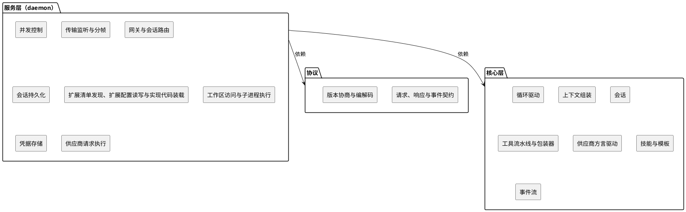

核心层运行不依赖服务层、协议、客户端和运行环境。服务层不依赖任何具体客户端。服务层以用户级单实例运行解决资源冲突、维护唯一状态，管理核心层实例。核心层保持无环境依赖的并发安全；进程、线程与资源调度由服务层 `Concurrency` 负责。

### 3.2 运行形态

- 服务层以守护进程形式长驻，可同时服务多个会话，会话之间彼此隔离，提供基础且必要的 CLI 命令供用户交互。
- 核心层各模块由守护进程在特定时机启动并统一管理。
- 客户端作为扩展包的一部分独立开发分发，经协议连接守护进程，由服务层的客户端发现与注册机制登记启动命令。
- 扩展来源包括随产品发布的内置扩展，以及工作区与软件配置目录中的扩展包。
- 扩展内容条目的发现与读取只发生在本地；被用户确认的条目，其内容或工具声明才进入请求的相应部分。
- 配置与状态包括供应商配置、模型能力元数据、扩展清点、新会话的默认扩展选择、默认 provider/model，以及默认工作区 `defaultWorkspace`；读取与写入由 `Extensions` 承担，`ProviderManagement` 只定义描述符 schema 并提供查询。

### 3.3 外部依赖与上下文

| 外部边界 | 相接层 | 说明 |
|---|---|---|
| 模型供应商接口 | 核心层定义，服务层执行 | 核心层以方言驱动构建请求与解析响应；网络调用与凭据由服务层提供 |
| 扩展包与分发 | 服务层 | 扩展以普通包或目录分发；服务层发现并读取包内清单，得到可用条目及其声明 |
| 文件系统与子进程 | 服务层 | 工作区访问与子进程执行由服务层实现；核心层只定义接口 |
| 凭据 | 核心层定义，服务层存储 | 核心层定义访问接口；服务层实现存储与刷新 |

### 3.4 请求处理流程总览

1. 客户端经协议发起请求，完成信息读取、消息入队等操作。
2. 服务层将请求路由到对应会话。
3. 循环驱动在 turn/step 中调用上下文组装：组装已持久化存储的历史消息记录和用户通过消息队列新增的消息，确定并组装当前智能体工作循环所需上下文。
4. 供应商方言驱动构建请求，经服务层提供的网络环境调用供应商提供的大语言模型接口。
5. 解析响应；若响应包含工具调用，进入工具流水线：按序包装、执行包装后工具、回填结果。
6. 装配内容写入会话：以适当的形式将上下文追加写入硬盘完成持久化；引擎事件经服务层转为协议事件推送客户端。
7. 当没有待执行的工具调用且没有可装配的已确认条目时，本轮结束；用户可在热会话进行中中止，中止语义见 §6.1。

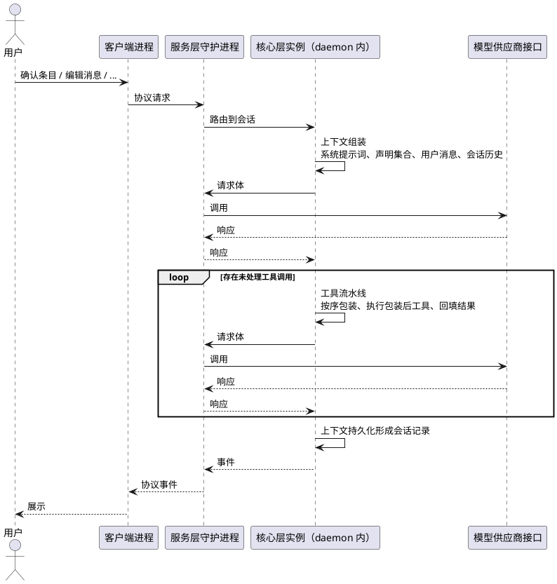

## 4 模块设计

本章给出模块清单及其对外契约、依赖关系与可替换点。

### 4.1 核心层模块

| 模块 | 职责 | 对外契约 |
|---|---|---|
| `AgentLoopDriver` | 驱动 turn/step，按序调用 `Context`、`LLMAdapter`、`Tools`，产出事件 | `run`、`cancel` |
| `TypeDefinition` | brand、JSON 值、错误基类 | 类型原语 |
| `LLMAdapter` | 方言编解码（构建请求、解析响应）与适配器注册表 | `buildRequest`、`parseChunk` |
| `ProviderManagement` | 供应商描述符 schema、方言注册、模型能力元数据查询 | `ProviderDescriptor`、`ModelDescriptor` |
| `Credentials` | 凭据访问 | `get`、`refresh` |
| `Context` | 消息队列、请求上下文装配、上下文来源接口、选择状态、追加消息/系统提示词/声明变化/压缩记录 | 装配与队列操作 |
| `Sessions` | 按树形结构持久化智能体消息与控制消息，按分支或全树读取 | `SessionRepository` |
| `Tools` | 工具与包装器契约、实现注册表、调用流水线 | `ToolDeclaration`、`ToolWrapper` |
| `Exec` | 命令与子进程执行 | `run` |
| `Skills` | 技能标准与实现注册表 | 技能条目 |
| `Template` | 模板类型与初始化计划 | `Template` |
| `EventBus` | 引擎事件流 | 发布、订阅 |

### 4.2 服务层模块

| 模块 | 职责 | 实现/依赖 |
|---|---|---|
| `Concurrency` | 子进程、子线程管理与资源冲突解决 | 锁、worker 管理 |
| `Transport` | 监听、连接与分帧 | 协议 |
| `Gateway` | 协议暴露、用户请求路由 | `Context`、`Sessions`、`AgentLoopDriver` |
| `SessionStore` | 实现会话存储接口 | `Sessions` |
| `TemplateStore` | 模板存储 | `Template` |
| `CredentialStore` | 实现凭据访问接口 | `Credentials` |
| `WorkspaceAccess` | 工作区访问 | 文件系统 |
| `ExecHost` | 实现命令与子进程执行接口 | `Exec` |
| `Extensions` | 清单发现与清点、扩展配置读写、内容注册分派、客户端启动注册 | `Tools`、`Skills`、`ProviderManagement`、`Context`、`ClientRegistry` |
| `ProviderHost` | 实现 `ExecuteProvider`：HTTP、凭据注入、超时、重试与传输分帧 | `Credentials` |
| `ClientRegistry` | 客户端注册信息的登记与查询 | 客户端启动 |

### 4.3 依赖关系

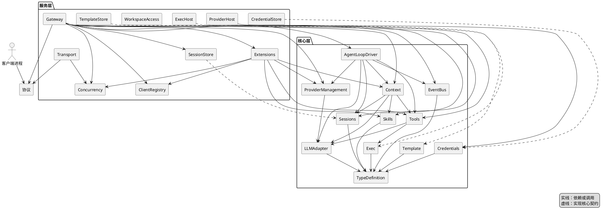

- 核心层内部单向依赖；核心层不依赖服务层、协议层或运行环境。
- 服务层实现核心层定义的接口，并持有核心层实例。
- 协议层被客户端进程与服务层共同依赖。
- 扩展通过核心层注册表与客户端启动注册写入内容；核心层不反向依赖扩展。
- `Context` 依赖 `Sessions` 读取事件并追加事件；`Sessions` 不依赖 `Context`。
- 在上述模块设计中，“热会话”等同于 `AgentLoopDriver` 实例， “回合” 是 `AgentLoopDriver` 的核心工作过程。
- `EventBus` 事件经 `Gateway` 推送客户端；`ClientRegistry` 由 `Extensions` 登记，`Gateway` 提供查询功能。

### 4.4 可替换点

| 关注点 | 契约定义位置 | 实现来源 |
|---|---|---|
| 供应商方言驱动 | `LLMAdapter`、`ProviderManagement` | 扩展 |
| 会话持久化 | `Sessions`（`SessionRepository` 接口） | `SessionStore` |
| 凭据 | `Credentials` 接口 | `CredentialStore` |
| 命令与子进程 | `Exec` 接口 | `ExecHost` |
| 上下文来源 | `Context` 来源接口 | 扩展 |
| 工具与技能实现 | `Tools`、`Skills` 契约 | 扩展、工作区与配置目录 |
| 模板存储 | `Template` 类型 | `TemplateStore` |
| 供应商请求执行 | `ExecuteProvider` | `ProviderHost` |
| 客户端 | `ClientRegistry` 注册信息 | 扩展 |

## 5 关键机制设计

### 5.1 循环与工具流水线

一次请求—响应构成一个 step；一轮 turn 可包含多个 step，工具调用结束后需要将结果回填，再次发起请求开始新的 step。每个 step 的过程：

1. 装配请求上下文（见 5.2）。
2. 调用模型供应商接口，解析返回。
3. 若返回中包含工具调用，进入工具流水线；否则判定是否继续。
4. 工具结果回填为工具结果消息，进入下一个 step。

工具流水线的阶段：

1. 解析工具调用。
2. 把解析出的工具声明作为最内层，按名称顺序用被选中的包装器逐层包装、添加钩子，得到新工具声明。
3. 执行包装后的工具。
4. 结果回填为工具结果消息。

`Tools` 导出包装器契约，提供指定错误类型供包装器或工具实现中断执行并提供反馈；服务层 `Extensions` 负责发现并装载包装器实现代码。

多个工具调用可串行或并行执行，结果按原始 `ToolCall` 顺序回填。一轮 turn 在没有待执行的工具调用且没有可装配的已确认条目时结束；用户中止时按 §6.1 处理。

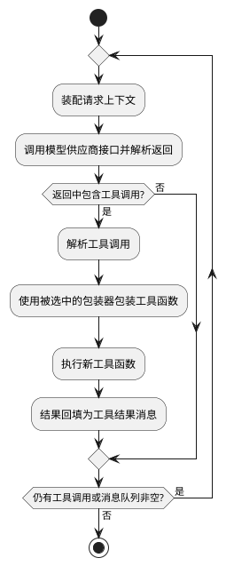

### 5.2 透明上下文

消息队列用于与用户交互，存储用户发送给智能体的消息和发送给本运行框架的控制消息。

构建用于发起智能体工作循环的请求体时使用的所有智能体上下文必须来源于会话记录和消息队列。上下文来源由用户显式启用，启用即授权其在首次选中装配时产出片段并固化；`Context` 先把片段追加为会话节点，再据此写入请求体。取消选择后再次启用复用已固化片段；零片段来源在每个 step 重试。`AGENTS.md` `SYSTEM.md` 等以文件形式存储的上下文，以及 skill 、 tool 等工作机制要求的上下文，只能在特定时机自动插入消息队列作为独立条目，在用户审查、修改完毕并发出确认信号后才能写入请求体及会话记录，绝不允许在确认信号发出后修改已确认条目的内容；新增条目属于后续装配。不允许将会话记录及消息队列以外的内容写入请求体。

会话记录包括直接写入请求体的“智能体消息”和不直接写入请求体的“控制消息”两个大类。每个会话的所有消息使用树型结构表示、存储，各消息节点必须有父节点指针，根节点的父节点指针指向自己。在每个 step 组装请求上下文时，根据当前消息节点的父节点指针可向上获取会话树的活动分支的完整记录，智能体消息可直接写入请求体，控制消息由 `role` 判别并指导 `Context` 完成组装工作；控制消息的 `content` 同样由 `ContentBlock[]` 承载。用户可在消息队列中操作智能体消息和控制消息，其中控制消息的内容不允许修改，声明类控制消息可整条增加或删除；压缩记录与中止标记只能由运行框架写入，用户只能整条删除。系统提示词作为角色为 `system` 的智能体消息写入请求体，用户可在队列中修改；已确认的 `source="instruction"` 消息按活动分支顺序参与装配，新增消息不替换已持久化的旧消息。控制消息只能整条增删，但压缩记录与中止标记的写入者受上述限制。

skill、tool、包装器、上下文来源等可选条目的选择变更使用声明类控制消息表示，某条目状态变更记为1，组装上下文时根据会话记录及消息队列中所有声明类控制消息按异或计算当前消息节点的声明集合并写入请求体；不保存完整选择集。

当请求上下文超出模型窗口时，按策略裁剪或压缩；压缩结果作为消息节点写入会话记录。窗口取当前模型描述符的 `contextWindow`；裁剪阈值、保留策略与压缩算法由详细设计定义，概设只约定裁剪不新增节点、压缩写入控制消息。

#### 5.2.1 创建空会话

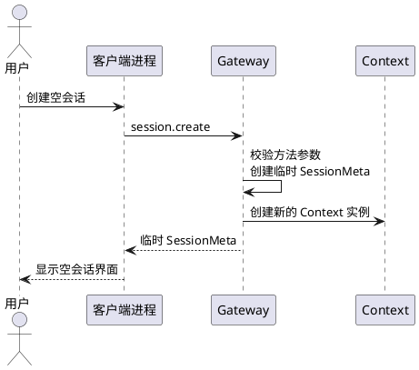

#### 5.2.2 查看会话记录

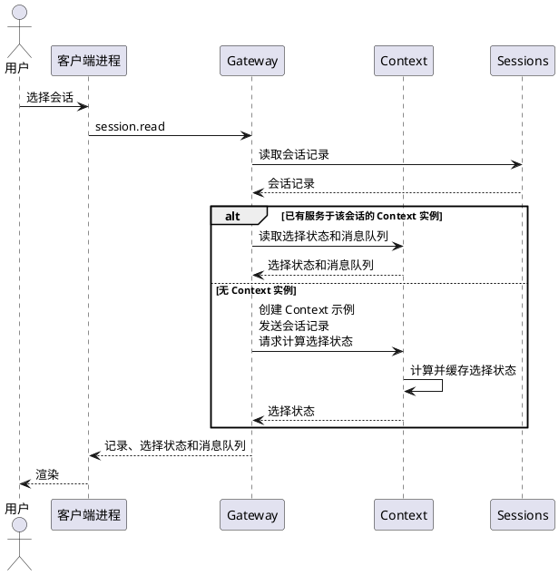

#### 5.2.3 选择条目

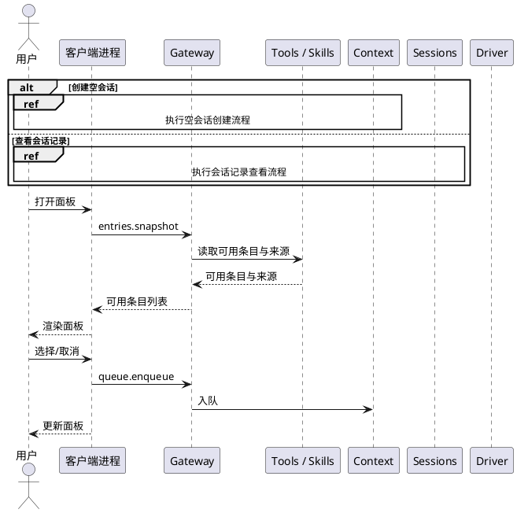

`session.read` 无 `nodeId` 返回完整会话树，有 `nodeId` 返回根到该节点的线性分支；临时会话只有空记录与当前队列，`selection` 返回全 false 。客户端根据需要，自行从消息队列计算 queue.enqueue 后的选择状态，`Context` 只在装配上下文时根据消息队列更新选择状态及缓存。

#### 5.2.4 发送与执行

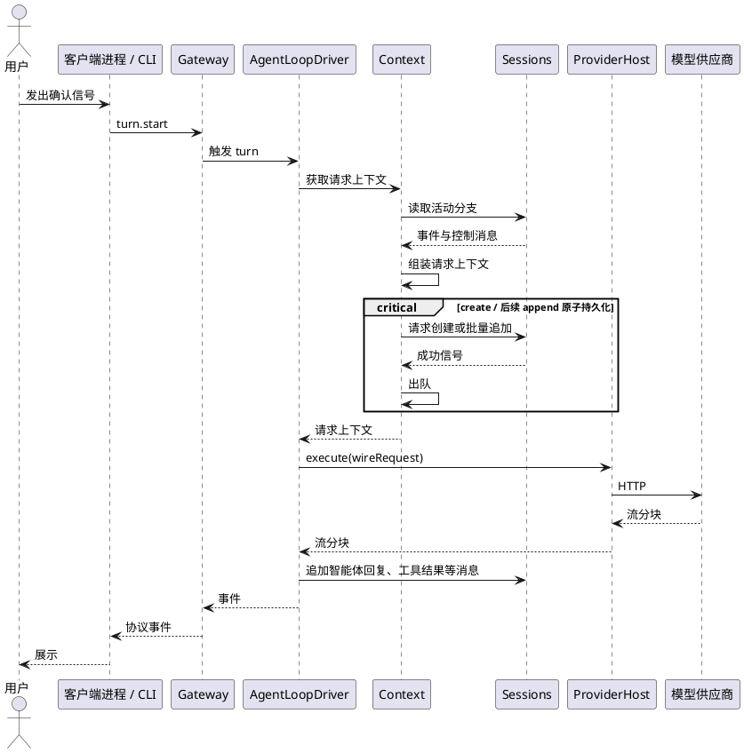

`execute` 由服务层实现并注入，见 §6.2。

首次 turn 由 `SessionRepository.create` 原子写入 `SessionMeta` 与初始节点；后续 turn 使用批量 `append`。全部成功后才出队；提交点前失败时队列保留、不产生节点；提交点后 I/O 失败可能已整批落盘，须重读确认，不能盲目重试。

### 5.3 会话持久化与读取

会话由消息节点按树形结构组织而成。会话树的消息节点不允许删除，分支通过父指针表达。各会话之间彼此隔离。`Gateway` 读取会话发送至客户端供其构建界面视图：无 `nodeId` 读取完整树，有 `nodeId` 读取根到该节点的分支。`Context` 在装配请求上下文时读取当前消息节点所在分支的历史消息记录，确定智能体可见消息序列，同时将其消息队列的各条目与装配结果发送给 `Sessions` 进行存储。

会话存储经统一接口访问，具体后端由服务层提供。

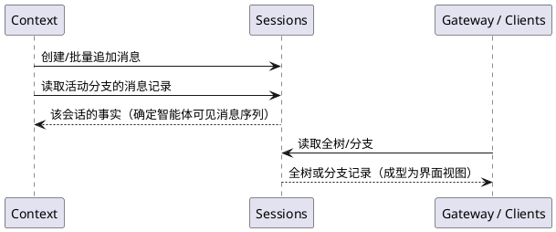

### 5.4 扩展接入

扩展是普通 npm 包或目录，用 `package.json` 的 `pisces` 字段或约定目录声明内容条目。

服务层 `Extensions` 在本地发现并读取清单，得到条目及其声明；该过程不执行扩展代码。扩展相关配置由 `Extensions` 读取，扩展代码不直接访问配置文件。

内容条目按类型分派：工具、包装器、技能、上下文来源进入核心层注册表。本阶段**不装配** `providers`
与 `clients`：清单里出现它们只记录 `extensions.unsupported_contribution`，不进入清点、不参与选择，
也不登记客户端启动命令。

各内容类型的生效行为：

- `tools`：声明通过 `RequestToolDeclaration` 投影到 `LlmRequest.tools`；实现代码在首次实际调用时才由
  宿主加载器导入并缓存，运行时身份与实现留在本地。
- `skills`：正文在发现阶段读取，首次选中装配时写入 `role=system` 的会话节点；取消选择只过滤请求，
  不删除已写节点，再选时复用历史正文。
- `context`：由用户启用的来源在首次选中装配时调用一次 `resolve`，片段先追加为会话节点，再参与装配；
  零片段来源不写入任何节点，并在下一次装配时重试；取消选择后的历史节点仍被保留但不再进入请求。
- `wrappers`：模块在首次实际调用时导入；工厂接收 sidecar `defaults` 与用户覆盖的合并配置，返回的
  包装器只能装饰 `execute`，不得修改 `id/name/description/parameters`，否则该次调用安全失败为
  `tool.wrapper_invalid`。
- 供应商与客户端：**本阶段未交付**。

选择状态与资格是两件事：`entries.snapshot.selection` 是已持久化的选择；`effective` 是本会话冻结定义
在当前清点下的资格投影（工具/包装器带 `definitionHash`/`configHash`），定义或配置哈希不再匹配时标记
`stale`，stale 工具不进 `LlmRequest.tools`、stale 包装器不执行，只能通过重新选择恢复。声明采用 all-toggle
快照：每次翻转（无论开启还是关闭）都为 tool/wrapper 名称附带完整定义快照，类型变化在覆盖旧定义之前检查。

宿主包 `@pisces/*` 由装载器映射到宿主实例，避免重复实例。

内置扩展以 `extensions/builtin` 容器分发；扩展的安装与版本控制由 npm、git 负责。

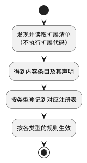

### 5.5 模板与项目初始化

模板是一份声明式预设，包含配置、目录与文件结构，以及可选的初始化脚本；提示词以文件形式随模板创建。

`Template` 负责模板类型与初始化计划的定义；`TemplateStore` 负责模板存储。

初始化流程：用户选择模板 → 解析并展示将要创建的目录、文件、冲突与将执行的脚本（含 argv 与超时） → 用户确认 → 服务层 `WorkspaceAccess` 创建目录与文件，`ExecHost` 执行初始化脚本（如有） → 读取提示词文件并记录项目 → 创建临时会话。

预览无副作用；应用必须显式确认（`confirmed: true`），已存在文件默认为冲突，需 `overwrite` 才覆盖。脚本失败不写项目记录、不创建会话；已创建文件不回滚。初始化脚本以 daemon 用户身份运行，不是沙箱；项目记录追加到 `<dataDir>/projects.json`。CLI 入口为 `pisces templates list|preview|apply`，见 `docs/templates.md`。

模板只引用可用的扩展条目与配置，不内嵌凭据。

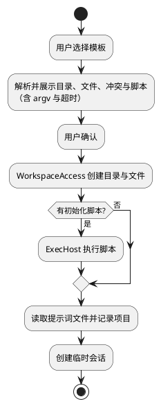

### 5.6 事件与协议暴露

`EventBus` 提供引擎内部事件流，记录循环与会话中产生的事件。

`Gateway` 把引擎事件转换为协议事件推送给客户端，并暴露操作入口：可用条目快照、消息队列操作。事件回调由 `Gateway` 注入，核心层不引用服务层实现。

协议层负责版本协商与编解码；分帧由服务层 `Transport` 的传输适配器完成。

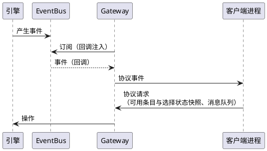

## 6 接口设计

本章给出各接口的形态；模块依赖与机制见第 4、5 章。本章只列关键签名，未在此定义的辅助类型（如 `Message`、`ContentBlock`、`JsonValue`、`Credential`、`ContextSourceContext` 等）由详细设计给出。

### 6.1 协议接口

协议层定义消息 schema、版本协商与编解码；分帧由传输适配器实现。

```ts
type RequestId = string;

interface Request<P = JsonValue> {
  id: RequestId;
  method: string;
  params: P;
}

interface Response<R = JsonValue> {
  id: RequestId;
  result?: R;
  error?: { code: string; message: string; data?: JsonValue };
}

interface Event<E = JsonValue> {
  event: string;
  data: E;
}
```

#### 方法与事件

| 域 | 方法 | 参数 | 结果 |
|---|---|---|---|
| 协议 | `protocol.hello` | `{ versions }` | `{ version, compatible }` |
| 会话 | `session.create` | `{ workspace?, templateId?, model?, provider?, systemPrompt?, extensions? }` | `SessionMeta` |
| 会话 | `session.list` | `{}` | `{ sessions: SessionMeta[] }` |
| 会话 | `session.read` | `{ sessionId, nodeId?, limit?, cursor? }` | `{ meta: SessionMeta, seq, records: SessionNode[], queue: QueueEntry[], selection, nextCursor? }` |
| 会话 | `session.configure` | `{ sessionId, model?, provider?, systemPrompt? }` | `SessionMeta` |
| 会话 | `session.subscribe` | `{ sessionId }` | 订阅确认，事件经推送 |
| 会话 | `session.unsubscribe` | `{ sessionId }` | `{ sessionId }` |
| 执行 | `turn.list` | `{}` | `{ turns: [{ sessionId, turnId, startedAt }] }` |
| 执行 | `turn.start` | `{ sessionId, nodeId? }` | `{ turnId, mode }` |
| 执行 | `turn.cancel` | `{ turnId }` | `{ cancelled }` |
| 供应商 | `provider.list` | `{}` | `{ providers: ProviderInfo[] }` |
| 消息队列 | `queue.enqueue` | `{ sessionId, entries }` | `{ ids }` |
| 消息队列 | `queue.edit` | `{ sessionId, id, content }` | `{ id }`，仅 `kind=agent` |
| 消息队列 | `queue.remove` | `{ sessionId, id }` | `{ id }` |
| 消息队列 | `queue.clear` | `{ sessionId }` | `{ ids }` |
| 可用条目 | `entries.snapshot` | `{ sessionId }` | `{ entries: EntrySnapshot[], selection, effective }` |
| 模板 | `template.list` | `{}` | `{ templates }` |
| 模板 | `template.preview` | `{ templateId, workspace }` | `TemplatePreview`（目录、文件、冲突、脚本含 `timeoutMs`） |
| 模板 | `template.apply` | `{ templateId, workspace, confirmed: true, overwrite? }` | `{ projectId, sessionId }` |
| 客户端 | `client.list` | `{}` | `{ clients }` |
| 客户端 | `client.start` | `{ id }` | `{ pid }` |

| 事件 | 触发 |
|---|---|
| `session.updated` | 会话记录追加 |
| `turn.started` | 活跃 turn 开始 |
| `turn.step` | 一个 step 完成 |
| `turn.ended` | 活跃 turn 结束，含中止 |
| `queue.updated` | 队列条目变化，载荷为当前完整 `QueueEntry[]` |
| `selection.updated` | 声明选择状态变化 |
| `client.launched` | 客户端进程启动 |

`SessionMeta` 是会话元数据，字段见 §6.5。服务层在 `session.create` 创建临时 `SessionMeta`，首次落盘前不写盘，也不出现在 `session.list`；`session.list` 只返回已落盘的 `SessionMeta`。`session.create` 未提供 `workspace` 时读取全局配置中的 `defaultWorkspace`；两者都没有时返回 `session.workspace_required`，路径不存在、不是目录或不可写时返回 `session.invalid_workspace`。`defaultWorkspace` 只来自全局配置；工作区配置 `.pisces/config.json` 需要先确定工作区才能读取，因此不参与默认工作区解析，也不提供该键。默认工作区必须是绝对路径，不自动创建。`provider`/`model` 必须成对提供，或成对省略并取配置中的 `defaults.provider`/`defaults.model`；仍无法解析时返回 `session.model_required`，显式值或默认组合不在 `provider.list` 中返回 `session.invalid_model`。`SessionMeta` 不含活动分支信息；默认活动分支为最新节点所在分支，由于会话记录只追加式写入，最新节点总能在会话记录末尾找到。运行状态不属于会话元数据：`turn.list` 返回当前活跃 turn，会话出现在其中即为热会话，否则为冷会话；`session.read` 返回 `meta`（临时或已落盘）、记录、待装配队列与选择状态，客户端按 `sessionId` 与 `turn.list` 合并，`session.read` 的 `meta` 为 `SessionMeta`。`session.configure` 的 `model`、`provider` 经校验后通过 `SessionRepository.updateMeta` 持久化，临时会话仅更新内存 meta；活跃 turn 使用启动时的模型与供应商，运行期间不允许 `session.configure`。`systemPrompt` 只更新 `source="instruction"` 的队列条目，没有则新增；不写 meta，不修改会话记录。若该会话存在活跃 turn，`session.configure` 返回 `turn.active`，不修改队列、meta 或记录；所有配置修改均须等待 turn 结束。扩展选择不在该方法中修改。模型能力（如上下文窗口）由 `provider.list` 的 `ModelInfo` 提供，不写入会话元数据。

`session.read` 的 `SessionMeta`、`SessionNode` 定义在 §6.5，`QueueEntry` 定义见本节；协议按相同字段序列化。

`provider.list` 返回 `ProviderInfo[]`。`ProviderInfo` 包含 `id`、`ready`、`models`；`ModelInfo` 包含 `id`、`contextWindow`、`maxOutput`、`modalities`、`pricing?`。`ModelInfo.id` 在所属 provider 内唯一，选择单位是 `(provider, model)`；`ready` 表示凭据有效且至少有一个模型，不可用或无模型的 provider 返回 `ready` 为 false（无模型时 `models` 为空），详细原因由 CLI `providers check` 提供。该清单不返回 `dialect`、`baseUrl`、`auth`、`headers` 等配置细节；`session.create`、`session.configure` 的 `provider`、`model` 取自该清单，不在清单中的组合由 daemon 拒绝。

`QueueEntry` 是 `Omit<SessionNode, "parentId" | "schemaVersion">`（`SessionNode` 见 §6.5），包含 `id`、`kind`、`role`、`content`、`source`、`createdAt` 与服务端写入的 `confirmedAt?`；`id` 由 `Context` 在入队时分配，仅在队列阶段有效，出队后作废。`queue.enqueue` 的 `entries` 为 `Omit<QueueEntry, "id" | "createdAt" | "confirmedAt">`，`session.read` 的 `queue` 返回 `QueueEntry[]`，`queue.updated` 携带当前完整 `QueueEntry[]`。

- 版本协商：连接建立时客户端先发 `protocol.hello` 交换版本；主版本不同返回错误并关闭连接，次版本向下兼容。daemon 升级会断开连接，客户端重连后重新握手。
- 传输：默认 Unix domain socket；连接建立时校验 peer 凭据，要求与 daemon 同用户。Windows 使用命名管道。
- 中止：`turn.cancel` 按 `turnId` 立即中止当前供应商流；正在执行的工具不被强制终止，`ToolInvocationContext.signal` 置为中止，工具可自行提前返回。中止后不再发起新的 step，当前工具结果回填后活跃 turn 结束；已产生的智能体回复与控制消息写入会话并标记为中断。客户端连接断开或调用 `session.unsubscribe` 不视为中止，活跃 turn 继续进行。CLI 的 `sessions cancel <id>` 先解析该会话的活跃 turn。
- turn 与 steer：无活跃 turn 时，`turn.start` 启动新的 turn（`mode` 为 `new`）；`nodeId` 可选，仅对已落盘会话有效，用于选择新 turn 的分支起点；未指定时从节点记录最后节点继续。已有活跃 turn 时，`turn.start` 只确认队列中新增条目，作为 steer 在下一个 step 边界装配，不启动第二个 turn（`mode` 为 `steer`）；此时不得带 `nodeId`。并发 `turn.start` 由 `Concurrency` 串行处理，后到者按 steer 处理。
- 会话创建：`session.create` 只由服务层创建临时 `SessionMeta` 与内存队列，不写盘；首次 `turn.start` 产生节点时，`SessionRepository.create` 原子写入 meta 与 nodes。`Sessions` 对所有节点统一分配 `id`/`parentId`，初始节点与后续追加没有区别。临时会话不进入 `session.list`；首次 turn 必须产生至少一个节点，否则报错且不落盘。
- 运行时：`turn.list` 给出活跃 turn 快照，`turn.started` / `turn.ended` 维护该集合；会话是否在运行由成员资格表示，不设 `status` 字段。
- 订阅：`session.subscribe` 按连接订阅一个会话，推送记录、队列、选择与 turn 事件；`session.unsubscribe` 移除当前连接的该会话订阅。退订只影响当前连接，不影响其他客户端，也不中止活跃 turn；连接断开自动清除该连接的全部订阅；重复退订幂等；不设退订事件，不另设队列订阅方法。
- 队列：`session.read` 的 `queue` 返回待装配条目；条目区分已确认与未确认，`turn.start` 确认当前队列，装配只消费已确认前缀。`queue.edit` 只作用于未确认的 `kind=agent` 条目；已确认条目可整条 `queue.remove` 或由 `queue.clear` 清除，但不可编辑。声明类控制消息可整条增加或删除；压缩记录与中止标记只能由运行框架写入，用户只能整条删除。无活跃 turn 时 `queue.clear` 清空全部待装配条目；有活跃 turn 时整个请求返回 `queue.entry_locked`。`turn.cancel` 清除尚未装配条目的确认状态。条目被装配取走后，不再接受 `queue.edit`/`queue.remove`。队列按入队顺序，不提供重排方法。
- 队列事件：`queue.updated` 在入队、编辑、删除、清空与出队后推送当前完整 `QueueEntry[]`；客户端整体替换本地队列。`session.read` 用于首次加载和重连，订阅仍由 `session.subscribe` 承担，不新增 `queue.subscribe`。
- 多客户端：队列写操作由 `Concurrency` 串行化；客户端以 `session.read` 的 `queue` 为初始快照、`queue.updated` 为增量，重连后重新 `session.read`；并发编辑按最后写入者获胜。
- 会话视图：`session.read` 在同一会话锁内返回 `meta`、`records`、`queue` 与 `selection`。无 `nodeId` 时 `records` 为完整会话树（扁平 `SessionNode[]`，按追加顺序），`selection` 按活动分支的声明类控制消息的 delta 异或；有 `nodeId` 时 `records` 为该节点向上至根的线性分支，`selection` 按该分支的声明类控制消息的 delta 异或。`queue` 始终是当前待装配条目；临时会话没有节点，带 `nodeId` 报错；`session.read` 不改变活动分支，分支继续由 `turn.start` 的 `nodeId` 选择。
- 事件：会话、队列与 turn 事件带 `sessionId` 与时间戳，客户端按 `sessionId` 路由多会话订阅。
- 事件推送：引擎事件和协议事件的相互转换由 `Gateway` 完成。
- CLI 与协议：`run`、`sessions`、`client`、`templates` 与只读的 `provider.list` 经协议方法完成；`providers check`、`extensions`、`auth`、`config` 仅 CLI。CLI 的管理命令直接读写本地配置、凭据与扩展目录，不经 daemon 协议；daemon 在创建会话或发起请求时读取，`config` 只影响此后创建的会话。协议不提供全局配置、凭据与扩展安装的写方法。

### 6.2 供应商接口

```ts
interface RequestToolDeclaration {
  name: EntryName;
  description: string;
  parameters: JsonObject;
}

interface LlmRequest {
  model: string;
  messages: Message[];         // 供应商无关的消息序列
  tools?: RequestToolDeclaration[];
  parameters?: JsonObject;
}

type LlmEvent =
  | { type: "content"; delta: string }
  | { type: "reasoning"; delta: string }
  | { type: "toolCall"; call: ToolCall }
  | { type: "usage"; usage: Usage }
  | { type: "stop"; reason: StopReason }
  | { type: "error"; code: string; message: string; retryable?: boolean };

interface LlmAdapter {
  readonly dialect: string;
  buildRequest(request: LlmRequest): WireRequest;
  parseChunk(chunk: string): LlmEvent[];
}

interface WireRequest {
  path: string;
  body: string;
  headers?: Record<string, string>;
}

type ExecuteProvider = (
  request: WireRequest,
  signal?: AbortSignal
) => AsyncIterable<string>;
```

适配器只做方言编解码；`RequestToolDeclaration` 仅含 `name/description/parameters`，适配器在边界把 `name` 编码为 `wireName`。`AgentLoopDriver` 调用服务层注入的 `ExecuteProvider`，由服务层 `ProviderHost` 执行 HTTP、凭据、超时、重试与传输分帧。`ProviderHost` 以 `ProviderDescriptor.baseUrl` 与 `WireRequest.path` 组合请求地址，注入凭据与 `headers`。HTTP 与传输错误由服务层映射为错误事件，供应商错误体由适配器解析。首个内置方言为 OpenAI-compatible Chat Completions（`openai-chat`）：不支持图像/音频输出，`wireName` 上限为 64 个 ASCII 字符；所有 system 消息按顺序发送，不重新发送已存储的 reasoning，默认请求 `stream_options.include_usage=true`，并兼容响应中的 `reasoning_content`/`reasoning` 文本增量。

供应商描述符由 `ProviderManagement` 定义，从软件配置目录发现或由扩展声明：

```ts
interface ProviderDescriptor {
  id: string;
  dialect: string;            // 适配器方言键
  baseUrl: string;
  auth: { type: "apiKey" | "oauth"; credentialRef: string };
  headers?: Record<string, string>;
  models: ModelDescriptor[];
}

interface ModelDescriptor {
  id: string;                 // 供应商作用域内的模型标识
  contextWindow: number;
  maxOutput: number;
  modalities: ("text" | "image" | "audio")[];
  pricing?: { input: number; output: number; currency: string };
}
```

协议 `provider.list` 返回的 `ProviderInfo` / `ModelInfo` 以描述符为只读投影，`ready` 由凭据状态计算；不含 `dialect`、`baseUrl`、`auth`、`headers`。

`ProviderDescriptor.models` 可以为空。空模型清单表示该 provider 当前没有可选模型，`models` 返回空数组且 `ready=false`。

### 6.3 工具与包装器接口

```ts
interface ToolResult {
  content: ContentBlock[];
  isError?: boolean;
}

interface ToolInvocationContext {
  sessionId: string;
  workspace: string;
  signal: AbortSignal;      // 协作式中止；daemon 不强制终止工具
  files?: WorkspaceAccess;  // 宿主注入；缺省表示工具必须安全失败
  exec?: Exec;              // 宿主注入；缺省表示工具必须安全失败
}

type ToolFunction = (args: JsonValue, context: ToolInvocationContext) => Promise<ToolResult>;

interface ToolDeclaration {
  readonly id: string;          // package#entry
  readonly source: string;      // 来源包/文件
  readonly name: string;
  readonly description: string;
  readonly parameters: JsonSchema;
  execute?: ToolFunction;       // 选中并导入后填充
}

type ToolWrapper = (wrapped: ToolDeclaration) => ToolDeclaration;

class ToolDeniedError extends Error {
  constructor(message: string) {
    super(message);
    this.name = "ToolDeniedError";
  }
}
```

- `files` 与 `exec` 由宿主（服务层 `Gateway` 在 `turn.start` 时）注入，扩展不得自行构造；契约与实现见 DDS §5.7。`files` 把相对路径限制在规范化工作区内并提供读写，`exec` 在超时、输出上限与环境变量白名单约束下执行子进程。任一能力缺失时，工具必须返回安全失败结果而不是抛错。
- 两者都**不是沙箱**：`exec` 以 daemon 用户权限运行，扩展代码可直接访问文件系统与网络，绕过 `files` 的路径限制。

- 扩展以 `ToolWrapper` 提供 hook 逻辑：包装器接收 `ToolDeclaration` 并返回新的 `ToolDeclaration`；包装后的 `execute` 可调用 `wrapped.execute`，before 与 after 的位置与配对由包装器自身决定。
- 多个包装器之间的执行顺序不构成契约，包装器必须设计为执行顺序无关；若某个包装器对 hook 的先后顺序有要求，应在包装器内部自行处理，不能依赖其他包装器的存在或流水线的包装顺序。
- `ToolFunction` 内抛出 `ToolDeniedError` 将立即结束工具执行，构造带 `isError` 及错误消息的工具结果。
- 每次工具调用只派发一次，结果按原始调用的 `id` 归属；包装器不得替换调用 `id`。
- 工具流水线的过程用伪代码示意如下：

```ts
// 包装器示例
let wrapper_example: ToolWrapper = (wrapped: ToolDeclaration): ToolDeclaration => {
  return {
    ...wrapped,
    execute: async (args, context) => {
      // pre-hook 代码 ...
      let result = await wrapped.execute!(args, context);
      // post-hook 代码 ...
      return result;
    },
  };
};

// 工具调用处理：
let tool: ToolDeclaration = ...
let wrappers: ToolWrapper[] = ...

// 若工具选择状态变更
tool.execute = ...

// 包装
let toolCopy = tool;
for (const w of wrappers) {
  toolCopy = w(toolCopy);
}

// 执行
const result = await toolCopy.execute!(args, context);
```

### 6.4 上下文来源接口

```ts
interface ContextSource {
  id: string;
  resolve(context: ContextSourceContext): Promise<ContextFragment[]>;
}

interface ContextFragment {
  source: string;          // 来源标识，随装配内容写入会话
  content: ContentBlock[];
}
```

`Context` 在首次选中装配时调用被启用的来源，先把片段追加为会话节点，再写入请求体；启用来源即授权其片段在首次选中时写入会话。上下文来源和技能内容作为 `role=system` 的智能体消息写入会话；装配时只将当前选中的来源/技能节点写入请求，取消选择不删除已写入节点，但不再参与组装。上下文来源的启用状态由 `entries.snapshot` 的 `selection` 表示，并以声明类控制消息记录；启用后才在首次选中装配时调用 `resolve`，零片段来源在每个 step 重试。上下文来源不提供独立的手动刷新方法。

### 6.5 存储与执行接口

```ts
interface SessionMeta {
  id: string;
  model: string;
  provider: string;
  workspace: string;
  createdAt: string;      // 创建时间
  schemaVersion: number;  // 格式版本
}

interface SessionNode {
  id: string;             // 持久化时由 Sessions 分配，会话内唯一
  parentId: string;       // 根节点指向自身
  kind: "agent" | "control";
  role: "system" | "user" | "assistant" | "tool" | "declaration" | "compaction" | "cancel";
  content: ContentBlock[]; // 工具结果带 toolCallId
  source: string;         // 扩展条目、上下文来源、系统提示词等
  createdAt: string;      // 写入时间
  schemaVersion: number;  // 记录格式版本
}

interface SessionRepository {
  create(meta: SessionMeta, nodes: SessionNode[]): Promise<void>;
  append(sessionId: string, nodes: SessionNode[]): Promise<void>;
  updateMeta(sessionId: string, meta: SessionMeta): Promise<void>;
  readBranch(sessionId: string, nodeId?: string): AsyncIterable<SessionNode>;
  readTree(sessionId: string): AsyncIterable<SessionNode>;
  list(): Promise<SessionMeta[]>;
}

interface Credential {
  type: "apiKey" | "oauth";
  value: string;
  expiresAt?: string;
}

interface Credentials {
  get(credentialRef: string): Promise<Credential | undefined>;
  refresh(credentialRef: string): Promise<Credential>;
}

interface ExecOptions {
  cwd?: string;
  env?: Record<string, string>;
  signal?: AbortSignal;
  timeoutMs?: number;
}

interface Exec {
  run(command: string, args: string[], options?: ExecOptions): Promise<ExecResult>;
}
```

- `Sessions` 定义 `SessionNode` 形态与分支语义，存储经 `SessionRepository` 接口访问；具体后端由服务层 `SessionStore` 实现。
- `SessionNode` 的 `parentId` 表达树结构，根节点指向自身；`readBranch` 从 `nodeId` 沿父指针上溯到根，按根到该节点的顺序返回；省略 `nodeId` 时以节点记录最后一个节点为分支末端；`readTree` 返回全部节点，按追加顺序返回。
- 服务层在 `session.create` 创建临时 `SessionMeta`；`SessionRepository.create(meta, nodes)` 原子写入 meta 与 nodes，`append(sessionId, nodes)` 批量原子追加；两者都不改写 meta。`updateMeta(sessionId, meta)` 仅用于已落盘会话，原子替换 meta，只允许 `model`、`provider` 变化，`id`、`workspace`、`createdAt`、`schemaVersion` 不变；临时会话只改内存 meta。`nodes` 由 `Sessions` 分配 id/parentId；`create`/`append` 要求 `nodes` 非空。
- `Sessions` 对所有节点统一分配 `SessionNode.id` 与 `parentId`；队列条目的临时 `id` 不写入节点，出队后作废。`SessionRepository` 只写入已确定 `id`/`parentId` 的节点；`create`/`append` 批量原子，不留下部分节点；提交点前失败时新批不可见，提交点后目录同步失败可能返回存储错误且整批已存在，调用方须重读确认。
- `SessionRepository` 只承载持久记录与元数据；活跃 turn、锁与中止信号由服务层 `Concurrency` 维护，不进入该接口。
- `Credentials` 与 `Exec` 同理：接口在核心层，实现在服务层。

### 6.6 扩展接口

扩展是普通 npm 包或目录，代码入口在 `pisces` 字段中声明：

```json
{
  "name": "example-pisces-extension",
  "pisces": {
    "tools": ["./src/tools/*.ts"],
    "wrappers": ["./src/wrappers/*.ts"],
    "skills": ["./resources/skills"],
    "context": ["./src/context/*.ts"],
    "providers": ["./providers.json"],
    "clients": [{ "id": "example-client", "entry": "./src/clients/example-client.ts" }]
  }
}
```

- 未提供 `pisces` 字段时，按约定目录发现内容条目：`tools/`、`wrappers/`、`context/` 下的脚本与
  `skills/<name>/SKILL.md`；sidecar 命名为 `<entry文件>.meta.json`，技能为相邻的
  `skills/<name>.meta.json`。
- 工具条目的 `id` 由包名与条目路径生成（`package#entry`），`source` 记录来源包与文件。
- 路径支持 glob 与排除。
- 宿主包 `@pisces/*` 由装载器映射到宿主实例，扩展不打包宿主包。
- 包装器 sidecar 的 `config` 形如 `{ "defaults": {…}, "schema": {…} }`；合并顺序为
  sidecar defaults < 用户 `entryConfig` 覆盖，schema 校验合并结果，`configHash` 是合并配置的
  规范化哈希，在声明确认时随定义冻结。工厂接收合并后的配置；模块导出的 `export const config`
  必须描述 sidecar defaults（未合并值），不一致时调用安全失败为 `tool.wrapper_invalid`。
- 工具/包装器/上下文来源的实现代码在首次实际使用（invoke 或 resolve）时才导入；清点、建会话、
  快照与确认都不执行扩展代码。
- 宿主内置 TypeScript 加载器（jiti 或等价实现），按需转译扩展入口，因此可直接分发 `.ts`/`.tsx`
  源码；加载器不因文件位于 `node_modules` 而拒绝加载，npm 安装的扩展包无需预构建。
- 加载器负责宿主包映射：`@pisces/*` 解析到宿主实例，扩展不打包宿主包；`tsconfig` 的 `paths` 与
  JSX 由加载器处理。
- 扩展的依赖安装在其自身目录的 `node_modules` 中，加载器按扩展路径解析；本阶段不哈希依赖树。
- 清单中的 `providers`、`clients` 不装配，只记录 `extensions.unsupported_contribution`；CLI、沙箱与
  热重载不在本阶段交付。

### 6.7 客户端命令与注册

daemon 提供专门的 `client` 命令，解析并校验请求的客户端，再按注册信息启动。

```ts
interface ClientRegistration {
  id: string;
  source: string;   // 所属 package 名称
  entry: string;    // 由 pisces 声明解析出的代码入口
}

interface ClientRegistry {
  register(registration: ClientRegistration): void;
  list(): ClientRegistration[];
}
```

daemon 启动客户端进程时，通过环境变量传入 daemon 的 socket 路径与客户端 id；客户端据此建立协议连接。

### 6.8 命令分类与约定

- `start`：启动 daemon 服务。
- `stop`：停止 daemon 服务；中止进行中的热会话并等待写盘完成。
- `status`：查看 daemon 服务状态。
- `client`：客户端管理。
  - `list`：列出已注册客户端。
  - `start <id>`：启动指定客户端。
- `extensions`：扩展管理。
  - `list`：列出已安装扩展。
- `providers`：供应商管理。
  - `list`：列出 daemon 已知的全部 provider 是否就绪（`id  ready|unready  models=<n>`）；只经协议 `provider.list`。
  - `check`：检查供应商就绪状态，输出具体原因；仅 CLI（未实现）。
- `models`：模型管理。
  - `list`：列出全部 provider 的模型（含 `ready=false` 与空模型清单者），按 provider `id` 字典序展平，
    `--provider <id>` 只保留该 provider；与协议 `provider.list` 同源。
- `auth`：校验供应商凭证；默认不输出明文。
- `config`：查看或修改配置，只影响此后创建的会话。
  - `list`、`get <key>`、`set <key> <value>`、`unset <key>`
  - 范围：新会话的默认扩展选择；默认 `provider`/`model`；默认工作区 `defaultWorkspace`；provider 与扩展声明；扩展清点只读
  - `defaultWorkspace` 只校验绝对路径格式；存在性与可写性在 `session.create` 时检查；只影响此后创建的会话
- `run [prompt]`：无客户端时的基本交互入口。
  - `--new`：强制新建会话。
  - `--continue`：继续最近一个会话。
  - `--session <id>`：指定会话；不存在时报错，配合 `--create` 新建。
  - `--create`：与 `--session` 同用，会话不存在时新建。
  - `--enable <patterns>`：设置该会话的扩展选择。
  - `--disable <patterns>`：取消该会话的扩展选择。
  - `--system-prompt <text>`：设置该会话的系统提示词。
  - `--use-default-system-prompt`：使用默认系统提示词。
  - `--model <name>`：设置该会话的模型。
  - `--provider <name>`：指定该会话的模型供应商。
  - `--print`：非交互输出。
  - `--json`：以 JSON 输出。
- `templates`：模板管理。
  - `list`：列出模板。
  - `preview <id>`：预览将创建的目录、文件与初始化脚本。
  - `apply <id> <workspace>`：确认后创建项目与会话。
- `sessions`：会话管理。
  - `list`：列出会话。
  - `export <id>`：以 JSONL 导出会话。
  - `cancel <id>`：中止该会话当前活跃 turn。
- `--help`：显示帮助。
- `--version`：显示版本。

约定：

- `--new`、`--continue`、`--session` 三者互斥。
- `run` 仅在用户通过参数显式指定时才使用系统提示词（`--system-prompt` 或 `--use-default-system-prompt`），否则不写入系统提示词。
- 扩展选择、系统提示词、模型为会话级，经 `run` 选项设置，只影响该会话。
- `config` 只影响新会话的默认选择，不改写既有会话。
- 管理命令（`providers check`、`extensions`、`auth`、`config`）直接读写本地配置、凭据与扩展目录，不经协议；供应商与模型的只读查询由协议 `provider.list` 提供。
- `meta.json` 由 daemon 维护，用户不应手工编辑；会话级设置经 `session.configure` 修改。
- 扩展的安装、更新与移除由 npm、git 完成，不在本软件生命周期内。
- `run` 交互中按 Ctrl-C 等同 `sessions cancel <id>`。

实现状态（本阶段）：CLI 已实现 `--help`、`--version`、`start`/`status`/`stop`、
`templates list`/`preview`/`apply`、`config list|get|set|unset`、`extensions list`、`sessions list`、
`provider list` 与 `models list`。`start` 以 detached
子进程启动 daemon，写入 pid 记录与日志，只有子进程存活、pid 记录仍指向它、且本 dataDir 的 socket
完成 `protocol.hello` 握手后才报告成功（总预算 10 s，轮询 50 ms）；`status` 结合进程存活、socket
探测与 pid 记录给出 `running`/`stopped`/`stale`/`unresponsive`/`unmanaged`，`--json` 输出同名
`state`；`stop` 仅在记录中的 pid 存活且同一 socket 应答后发送 `SIGTERM`，最多等待 10 s，陈旧记录与
PID 复用防护见 §8.1。模板命令经单个短连接调用 `template.*`，`apply` 必须显式 `--confirm`，
详见 `docs/templates.md`。`config` 直接读写全局与工作区配置层，`extensions list` 只做本地发现
且不加载代码，`sessions list` 经协议 `session.list` 列出已落盘会话。`provider list` 与
`models list` 都只经协议 `provider.list`（不读本地 provider 定义）：前者每行
`id  ready|unready  models=<n>`，列出全部 provider；后者把模型展平为 `provider/model`，provider 按
`id` 字典序、模型保持 daemon 顺序，`--provider <id>` 只保留该 provider，未知 id 由 CLI 以
`provider.not_found` 退出 1。其余命令（`run`、`sessions export|cancel`、`client`、`providers check`、
`auth`）仍为目标设计，**未实现**。全局配置为统一 schema：CLI 组 `dataDir`/`providers`/`defaults`/`templatesDir`
与扩展组 `defaults`/`defaultWorkspace`/`extensions`/`entryConfig` 共存，两个加载器互不拒绝；
默认 provider/model 只使用 `defaults`（旧 `defaultProvider`/`defaultModel` 已移除），CLI
接受但不校验、不使用扩展键。CLI 仅支持 Linux x64，
只暴露 `openai-chat` 方言；配置、凭据与恢复步骤见 `docs/cli.md`。

### 6.9 模板接口

协议只传输展示与预览形态：

```ts
interface TemplateInfo {
  id: string;
  name: string;
  description?: string;
}

interface TemplatePreview {
  directories: string[];
  files: { path: string; content: string }[];
  conflicts: string[];
  initScript?: { command: string; args: string[]; timeoutMs: number };
}
```

完整 `Template`（含 `config`：`provider`/`model`/`extensions`/`systemPromptFile`）只存在于 daemon
的模板加载模块，不导出到协议。

```ts
interface ProjectRef {
  id: string;
  templateId: string;
  workspace: string;
  createdAt: string;
}
```

`TemplateStore` 读取并校验模板，并记录由模板衍生的项目；用户确认后，`WorkspaceAccess` 创建目录与文件，`ExecHost` 执行 `initScript`（如有）；模板的配置作为新会话的初始值；模板创建的文件作为工作区内容，需要进入请求体的提示词按 §5.2 的队列与确认流程处理。

实现状态：`template.list` 返回 `{ templates }`；`template.preview` 返回 `TemplatePreview` 且无副作用；
`template.apply` 要求 `confirmed: true`，冲突需 `overwrite`，预检失败不写盘，成功后追加 `ProjectRef` 并
返回 `{ projectId, sessionId }`，会话首次 `turn.start` 才落盘；`session.create` 的 `templateId` 只解
析模板配置作为默认值，不写盘、不执行脚本。宿主通过 `startDaemon({ templates: { configDir } })` 装配，
未装配时 `template.*` 仍为 `protocol.unknown_method`。错误码、脚本与路径规则、CLI 与已知限制见
`docs/templates.md`。

## 7 数据设计

### 7.1 会话记录

会话树由 `SessionNode` 组成，节点只追加、不删除；字段见 §6.5，`parentId` 表达树结构，根节点指向自身。

控制消息的子类型由 `role` 表示：

- `declaration`：记录工具、包装器、技能、上下文来源等可选条目的状态翻转 delta；每个名称出现一次表示翻转一次，选择按异或计算；选择标识使用条目名称，不使用运行时分配的 id。
- `compaction`：记录被压缩的消息范围与摘要内容。
- `cancel`：记录活跃 turn 被中止的位置与原因。

新会话由服务层创建临时 `SessionMeta` 与内存队列，首次装配前不写盘；首次 `turn.start` 产生节点后，`SessionRepository.create(meta, nodes)` 原子写入 meta 与 nodes。此前 `session.list` 不包含该会话，磁盘上不产生空会话目录；首次 turn 必须产生至少一个节点，否则报错且不落盘。`Sessions` 对所有节点统一分配 `id`/`parentId`，初始节点与后续追加没有区别；后续装配使用批量 `append`。会话默认活动分支由节点记录最后一个节点表示，`append` 只追加，不改写 meta。

装配时以指定的 `nodeId` 为起点沿父指针上溯得到活动分支，在无 `nodeId` 时使用沿会话记录末行节点沿父指针上溯得到的默认活动分支；`Context` 据此确定智能体可见消息序列。`session.read` 无 `nodeId` 时读取完整会话树，有 `nodeId` 时读取根到该节点的分支；控制消息的 `content` 同样使用 `ContentBlock[]`，声明类控制消息的 delta 按异或计算 selection。裁剪只影响本次装配的可见序列，不新增节点；压缩产生一条控制消息。队列条目的临时 `id` 不写入节点、出队后作废；持久化与出队在同一临界区完成，失败时条目保留且不产生节点；崩溃丢失的队列条目不参与恢复；首次落盘前的临时 meta 与队列随 daemon 退出丢失。

### 7.2 存储布局

| 位置 | 内容 |
|---|---|
| 软件配置目录 | 统一 `config.json`（CLI 键 `dataDir`/`providers`/`defaults`/`templatesDir` 与扩展键 `defaults`/`defaultWorkspace`/`extensions`/`entryConfig`）、`credentials`（由 `CredentialStore` 管理）、`templates/`、`extensions/` |
| 数据目录 | `projects.json`（模板衍生项目）、`sessions/<sessionId>/meta.json`（会话元数据）、`sessions/<sessionId>/events.jsonl`（`SessionNode` 记录）、`sessions/<sessionId>/active-turn.json`（未完成 turn 的运行时标记） |
| 工作区 | `.pisces/config.json`（工作区级扩展配置；不提供 `defaultWorkspace`）、扩展目录 |

- 节点记录为 `SessionNode` 的 JSONL，按追加顺序写入；`meta.json` 只对已落盘会话存在，保存 §6.5 的 `SessionMeta`（会话标识、创建时间、模型、供应商、工作区与 schema 版本）。空会话没有 `meta.json`，也不产生会话目录；默认活动分支是节点记录的最后一行所在分支。
- `active-turn.json` 保存未完成 turn 的 `turnId` 与开始时间，是服务层运行时恢复标记；不进入 `SessionMeta`、不写入 `events.jsonl`、不参与选择或导出。
- `defaultWorkspace` 只存在于软件配置目录的 `config.json`；工作区确定后才读取 `.pisces/config.json`，因此工作区配置不参与默认工作区解析，也不提供该键；若出现则按未知配置键处理。
- `SessionRepository.create` 原子写入 `meta.json` 与 nodes；`append` 批量原子追加 nodes；两者都不改写 `meta.json`。`updateMeta` 仅原子替换 `meta.json`，不写 nodes；其原子性与并发约束同 `create`/`append`。写入原子性由存储实现保证；fsync 与批量策略由详细设计决定。
- 同一会话的写入由 `Concurrency` 串行化；客户端不持有全局锁。
- 配置文件与节点记录不保存凭据明文，只保存 `credentialRef`。
- 配置与凭据由 CLI 写入，daemon 按使用时机读取；`meta.json` 由 daemon 维护。

### 7.3 导出

`sessions export <id>` 导出 JSONL：首行为会话元数据，其后为活动分支的节点，按从根到当前的顺序排列，包含控制消息与压缩记录。导出不包含凭据；会话内容可能含敏感信息，由用户自行处置。

## 8 运行与非功能设计

### 8.1 部署与生命周期

- 本阶段 daemon 仅支持 Linux x64 与 Node.js >= 22.19.0；macOS 与 Windows（命名管道）仍为目标设计，未实现，非 Linux 平台在绑定前以 `daemon.unsupported_platform` 失败。
- daemon 以用户级单实例运行：启动时对 `<dataDir>/run/pisces.lock` 取 `flock` 并绑定 `<dataDir>/run/pisces.sock`（权限 `0600`）；锁已被占用时以 `daemon.lock_busy` 退出，且不删除存活实例的 socket。
- 本阶段已提供 CLI `start`/`status`/`stop`（见 `docs/cli.md`）与只接受 `dataDir`/`providers`/
  `defaults` 的 `config.json` 加载器；daemon 本身仍不读取配置，嵌入程序调用
  `startDaemon({ dataDir, providers, providerHost, ... })` 启动，返回的 `DaemonHost` 提供
  `socketPath`、`initializationIssues`、`recoveryIssues`、`status()` 与 `stop()`。CLI 的 pid 记录、
  日志、socket/lock 文件与退出码约定见 DDS §7.5；`run`、`sessions` 等命令未实现。daemon 只监听本地
  Unix socket，不监听网络地址。
- 连接在读取任何协议字节前用原生 `SO_PEERCRED` 校验 peer UID 必须等于 daemon 有效 UID；不一致只销毁该连接。原生插件为仓内 plain C Node-API，使用固定 `node-gyp` 编译为被忽略的 `packages/daemon/native/peercred.node`，需在测试前按当前 Node ABI 显式构建；缺失或构建失败以 `daemon.native_unavailable` 拒绝启动，无降级认证。
- `stop()` 先阻断新帧并停止 accept，等待已受理请求与尽力取消活跃 turn，再关闭连接、按 inode 清理 socket、释放锁并 dispose `Gateway`；无法完成时以 `daemon.stop_incomplete` 失败并保留锁、标记与 `quiescing` 状态，不自动强杀进程，也不声称已优雅停止。
- CI 配置 Linux x64 的 Node 22.19.0/24/26 矩阵，先构建原生插件再执行完整测试、两个 `tsc`、Biome 与边界扫描；未 push 前不得将远端矩阵结果视为已验证。
- 临时会话在首次落盘前只存在于服务层内存；daemon 退出即丢失，磁盘不产生空会话。已落盘会话按正常流程恢复。
- 热会话结束后成为冷会话；冷会话可从持久化记录恢复为新的热会话。
- daemon 异常退出后，重启时恢复已持久化的冷会话；未完成的热会话标记为中断。`turn.start` 对已落盘会话在启动时写入 `active-turn.json`，临时会话在首批节点落盘后补写；turn 正常结束或失败时删除。重启读取该标记，向对应会话追加 `role=cancel` 控制消息（原因为 daemon 重启）并删除标记。

### 8.2 性能与可靠性

- 供应商响应以流式事件处理，不等待完整响应。
- 装配活动分支的复杂度与该分支长度成正比；`session.read` 无 `nodeId` 读取完整树时与节点数成正比，有 `nodeId` 时与分支长度成正比；不复制整棵会话树。
- 工具调用可并行，并发数由服务层限制；结果按原始调用顺序回填。
- 会话节点只追加；`create`/`append` 批量原子完成，失败时不留下半条记录。
- 队列在装配前驻留内存，装配时取走并写入会话；这是有意的取舍，daemon 崩溃会丢失消息队列中的条目。
- 事件推送与请求处理不共享全局锁；同一会话的 turn 串行执行。

### 8.3 安全边界

- 安全机制以用户知情权与显式选择为核心，不提供沙箱。
- 扩展代码在 daemon 进程内以用户权限执行；安装与安装脚本在本软件生命周期之外，不由本软件执行或拦截。
- 凭据由 `CredentialStore` 保存，不进入配置文件、会话记录或导出内容。
- daemon 默认只监听本地 socket，不监听网络；接入方需与 daemon 同用户。
- 会话导出可能包含敏感内容，是否导出由用户决定。

### 8.4 出错处理

错误分类与错误码：

| 类别 | 错误码示例 | 处理 |
|---|---|---|
| 协议 | `protocol.invalid_request`、`protocol.version_mismatch` | 返回错误响应；版本不兼容时拒绝连接 |
| 供应商传输 | `provider.transport`、`provider.timeout` | 按 429/5xx 重试并退避；4xx 除 429 外不重试；取消不重试 |
| 供应商响应 | `provider.invalid_response`、`provider.refusal` | 转为错误事件，结束当前 step |
| 工具 | `tool.failed`、`tool.denied` | 以 `isError` 工具结果回填，继续循环 |
| 会话 | `session.model_required`、`session.invalid_model`、`session.workspace_required`、`session.invalid_workspace` | 拒绝创建；不写临时会话目录 |
| turn | `turn.active` | 活跃 turn 中调用 `session.configure` 时整体拒绝，不部分更新 |
| 存储 | `storage.io`、`storage.corrupt` | 立即失败，不返回部分结果；报告会话 id |
| 事件 | `event.publish_failed` | 同步 EventBus handler 抛错；已提交节点、队列状态、head 推进与已分配 `seq` 保留并允许序号空洞，不重试、不回滚；在 driver 内作为终态 turn 错误 |
| 配置 | `config.invalid`、`config.unknown_key` | 拒绝写入并返回校验错误 |

- 客户端收到 `Response.error.code` 与可读消息；错误消息不包含凭据。
- 工具内抛出 `ToolDeniedError` 立即结束该工具执行，构造错误结果。
- `event.publish_failed` 表示事件是通知而非事务日志：handler 同步失败后不重放、不回滚已提交状态；turn 中发生时通过 `turn.ended.error` 结束。
- daemon 崩溃后按 §8.1 恢复；未完成的热会话标记为中断，由用户决定是否继续。

### 8.5 构建与分发

- 使用 pnpm 工作区多包组织；`tsc -b` 构建 `protocol`、`core`、`daemon` 三个包。
- 内置扩展随产品以 `extensions/builtin` 分发；外部扩展为普通 npm 包或目录。
- 扩展加载器（jiti 或等价）随宿主分发，负责运行时转译 `.ts`/`.tsx`；扩展源码不要求预构建。
- 客户端作为扩展包的一部分独立开发、分发，经协议连接 daemon。
- 扩展的安装、更新与移除由 npm、git 完成，不在本软件生命周期内。
- 版本号遵循 semver；协议版本与包版本独立管理。

### 8.6 兼容与迁移

- 协议主版本不同拒绝连接；次版本向下兼容。daemon 升级会断开旧连接，客户端重连后重新执行 `protocol.hello` 握手。
- 会话记录带 `schemaVersion`；读取旧版本时按迁移规则升级，迁移失败则不加载并报告错误。
- 扩展接口版本与宿主版本独立；不兼容的扩展在发现阶段标记为不可用，不阻断 daemon 启动。
- 废弃字段与命令先标记、后移除；移除前至少保留一个次版本。
