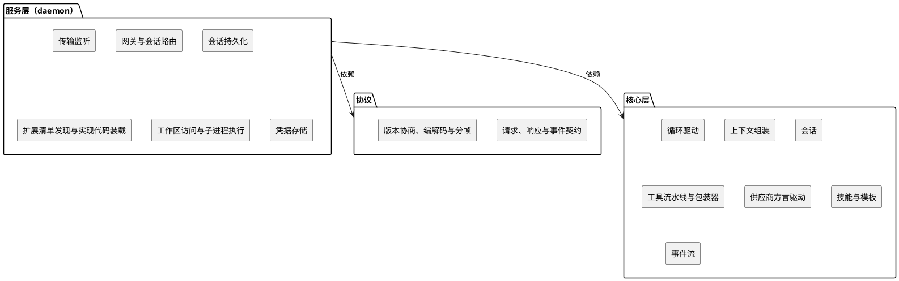
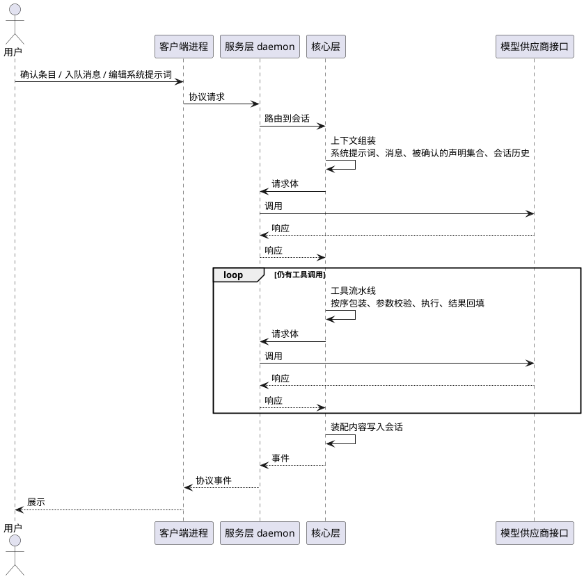
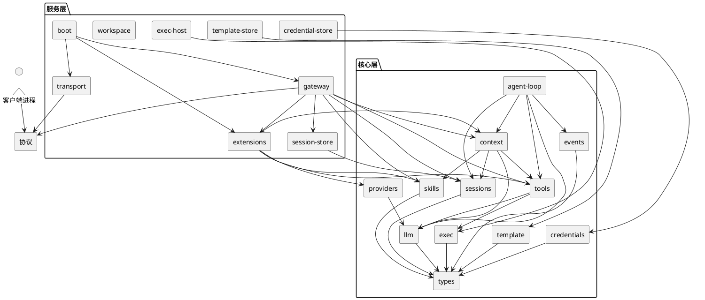
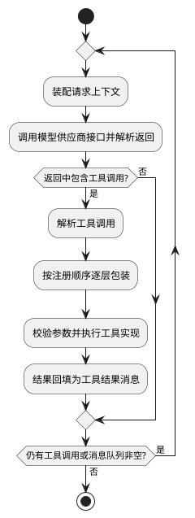
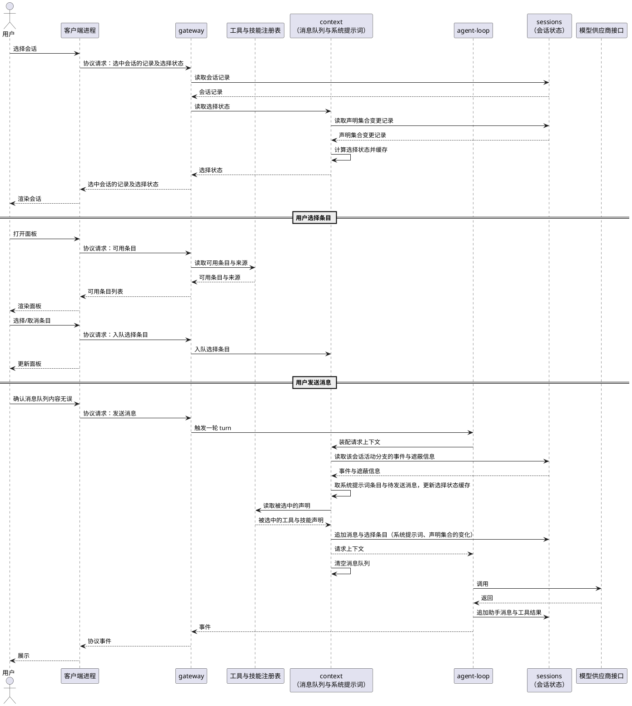
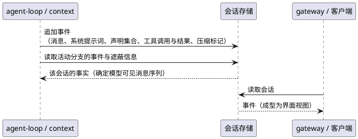
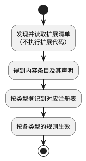
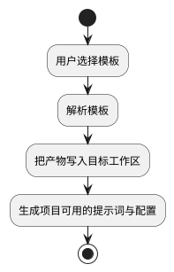
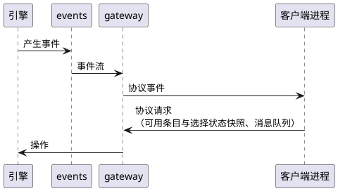

# 概要设计

## 1 引言

### 1.1 编写目的

本文档整合本项目立项与前期讨论形成的上下文，明确设计理念、总体结构与关键机制，作为后续详细设计、实现与测试的共同基准。

本文档同时承担消歧职责。本项目的多项设计选择不同于同类智能体运行框架的常见做法，阅读时若按外部产品或既有惯例望文生义、过度解读，会得出与本文不符的结论。凡本文与其他资料、同类产品惯例不一致之处，以本文为准；本文未明确的内容，应视为尚未决定，不得由惯例推断。

### 1.2 项目背景

**会话前审查透明**

智能体运行框架的构建系统提示词的标准流程包含两个动作，先是发现并读取特定目录下文件，然后将声明内容写入系统提示词。运行框架以纯文本的形式读取文件是安全的，在其中的声明被写入系统提示词并发送到智能体以后，智能体将有权决定是否执行特定动作。

多数同类框架将这两个动作合并为一步，把发现到的声明全量、隐式地写入系统提示词，恶意或被投毒的资源会在用户不知情的情况下进入智能体上下文，引导智能体进行破坏性任务。针对这一风险，本项目提出在「发现、读取文件」与「写入系统提示词」两个动作之间增加显式确认环节。用户在会话开始前可审阅运行框架发现的声明，自行选择需要添加到系统提示词的条目。

**会话后溯源透明**

智能体只能通过运行框架提供的工具、MCP操作用户设备，其一切行动都将在运行框架中留下痕迹。在溯源意外事件的过程中，运行框架的记录远比智能体充满幻觉与辩解的总结可靠。

### 1.3 项目范围

本项目设计并实现一个基于 TypeScript 的智能体运行框架（Harness）。框架把大语言模型供应商接口调用封装为工作循环，负责请求构建与返回解析、会话持久化、工具调用请求与响应等，降低智能体工作流程的使用门槛。

框架的核心设计理念为透明可控与模板化。后端以服务形式运行，不依赖客户端。

本文档覆盖：总体架构、模块划分与职责、关键机制、接口与数据、非功能设计、构建与分发。

本文档不覆盖：函数级实现细节、测试用例、项目进度与分工。

### 1.4 设计理念

**透明可控**

- 系统提示词不隐式写入请求体，而是插入消息队列，用户可查看、修改、删除。
- 工具与技能声明经显式选择后写入系统提示词；未被选中的声明不写入系统提示词。
- 持久化保存提示词输入、工具调用记录，作为事后溯源的事实依据。
- 保证用户对智能体工作的知情权，允许用户根据安全需求构建相应防护机制；不假想安全威胁并为其实现繁杂安全机制。

**模板化**

- 对用户总结的可复用工作流程，以项目模板的形式予以支持，将初始化流程用代码表示后可直接执行。

**服务化与客户端解耦**

- 后端以 daemon 形式长驻，对外只暴露协议；客户端经协议连接，可替换、可并存。

**增量开发**

- 遵循 KISS 原则，按阶段推进增量开发，优先保证核心功能和创新点模块交付。

**一般性优先**

- 不针对特定模型优化，不预设复杂但不通用的工具，保证框架与智能体的交互具有一般性。

### 1.5 读者与阅读约定

读者为本项目的设计与开发人员。

- 术语以本项目约定为准，不套用同类产品的术语含义。
- 本文档描述设计意图与约束，不规定实现细节。
- 本文档未明确的内容视为未定，不得由惯例或外部产品推断。

### 1.6 术语表

- 智能体（Agent）：对大语言模型在特定任务中的身份声明。
- 智能体运行框架（Harness）：在特定主机上运行，为智能体工作提供支持的运行环境。
- 工作区（Workspace）：目录结构、特定文件内容符合用户工作流程需要的工作路径。
- 项目模板（Project Template）：在特定任务中，工作区目录结构、特定文件内容要求，及为满足该要求必需的初始化流程的表示。

## 2 设计目标与约束

### 2.1 设计目标

**透明可控（核心目标）**

- 系统提示词、工具和技能声明插入用户消息队列，供用户增删查改，不隐式写入请求体，只有用户确认无误后才随用户消息发送到智能体触发其工作循环。
- 采用树形结构只加式组织会话过程记录，作为事后溯源的事实依据。
- 保证用户在智能体工作循环全程具有充分知情权：进入工作前可检查、修改使用的提示词和声明集合，工作过程中可观察动态，工作结束后可根据会话记录溯源因果。

**模板化**

- 提供项目模板机制，管理用户自定义的提示词、外部软件配置文件等预设，以及由模板衍生的同类项目，以代码或脚本为主、辅以智能体技能的方式提供工作区初始化功能。

**可扩展**

- 工具、包装器、技能、上下文来源、大语言模型供应商配置与客户端均以可拔插的扩展形式提供，软件核心层只定义相关标准与注册表。
- 扩展复用 Node 生态的包格式与分发机制。

**关注点分离与可测试**

- 核心层模块只含环境、传输无关的逻辑，可独立于文件系统、子进程与网络测试。
- 环境相关职责集中于服务层，便于替换与移植。

**服务化与客户端无关**

- 后端以 daemon 形式长驻运行，提供基本的 CLI 命令供用户进行直接的简单交互，提供协议供客户端连接。
- 客户端不持有全局锁。后端通过必要的锁，保证多个客户端可同时参与到同一个智能体工作循环中。

**一般性**

- 不针对特定大语言模型及其供应商优化，优先实现高频使用的泛用工具，保证智能体与运行框架的交互具有一般性。

### 2.2 设计约束

**技术约束**

- 实现语言为 TypeScript，运行时为 Node，包管理器使用 Pnpm，模块系统为 ESM。
- 采用工作区多包组织，内部包通过工作区协议互相引用。
- 协议传输无关，可挂载多种传输。

**架构约束**

- 分层依赖方向固定为：客户端进程 → 协议 ← 服务层 → 核心层。
- 核心层不得依赖服务层、客户端或运行环境；服务层不得依赖具体客户端。
- 服务层对外只暴露 CLI 命令和客户端协议。

**接口约束**

- 存储、凭据、命令与子进程执行、供应商适配、工具契约、包装器契约、上下文来源均以接口或贡献点定义。
- 具体实现（持久化后端、凭据存储、供应商方言驱动、工具与包装器实现等）以扩展的形式存在，可替换、可插拔。

**数据约束**

- 用户在会话中发送的具体消息、操作统一暂存到消息队列，并在智能体工作循环开始后写入硬盘持久化存储。
- 会话可根据持久化存储中恢复，并继续进行。
- 系统提示词与声明集合显式写入消息队列保证用户知情，不隐式注入。
- 类型原语（brand 机制、JSON 值、错误基类）集中定义，具体标识由各模块定义。

**扩展约束**

- 扩展为普通 npm 包或目录，用包的字段或约定目录声明内容条目。
- 扩展内容条目的发现基于声明式清单，扩展代码仅在客户端启动或智能体工作循环中执行；内容条目选择状态更新后，向用户消息队列插入相应消息，随用户消息发送到智能体工作循环中通知修改。
- 扩展的依赖与分发复用 Node 生态机制。

**过程约束**

- 增量交付，优先核心模块与体现创新点的模块。
- 遵循 KISS，避免过度设计。

**安全约束**

- 安全机制以用户知情权与显式选择为核心，不预设复杂安全机制。
- 包的安装与安装脚本在本软件生命周期之外，不由本软件执行或拦截。

**内容与资源约束**

- 上下文按模型窗口裁剪与压缩。
- 选中决定哪些声明写入系统提示词；未选中的条目不出现在系统提示词中。

## 3 总体设计

### 3.1 分层与依赖方向

系统分为三层：协议、服务层、核心层。

- **协议**：传输无关的请求、响应与事件契约，包含消息 schema、版本协商、编解码与分帧，可挂载多种传输，供用户端程序通信使用。
- **服务层**：常驻的 daemon，持有核心层实例，承担与运行环境相关的职责，包括传输监听、客户端入口、会话持久化、扩展清单发现与实现代码装载、工作区访问、子进程执行、凭据存储；对外只暴露协议。
- **核心层**：与环境和传输无关的逻辑，包括与供应商无关的消息类型、供应商方言驱动、循环驱动、上下文组装、会话持久化、工具标准与流水线、技能标准、模板逻辑与事件流。

依赖方向固定为：协议 ← 服务层 → 核心层。



核心层运行不依赖服务层、协议、客户端和运行环境；服务层不依赖任何具体客户端。服务层以用户级单实例运行解决资源冲突、维护唯一状态，核心层根据功能特点选择异步、多线程、多进程等方案满足并发需求。

### 3.2 运行形态

- 服务层以 daemon 形式长驻，可同时服务多个会话，会话之间彼此隔离，提供基础且必要的 CLI 命令供用户交互。
- 客户端作为扩展包的一部分独立开发分发，经协议连接 daemon，由服务层的客户端发现与注册机制登记启动命令。
- 扩展来源包括随产品发布的内置扩展，以及工作区与软件配置目录中的扩展包。
- 扩展内容条目的发现与读取只发生在本地；被用户确认的条目，其声明才写入系统提示词。
- 配置与状态包括供应商配置、模型能力元数据与扩展清点。

### 3.3 外部依赖与上下文

| 外部边界 | 相接层 | 说明 |
|---|---|---|
| 模型供应商接口 | 核心层定义，服务层执行 | 核心层以方言驱动构建请求与解析响应；网络调用与凭据由服务层提供 |
| 扩展包与分发 | 服务层 | 扩展以普通包或目录分发，安装在本软件生命周期之外；服务层发现并读取包内清单，得到可用条目及其声明；被用户确认的条目，其声明写入系统提示词 |
| 文件系统与子进程 | 服务层 | 工作区访问与子进程执行由服务层实现；核心层只定义接口 |
| MCP | 核心层定义，服务层连接 | 核心层定义工具桥接与注册；服务层建立连接与传输 |
| 凭据 | 核心层定义，服务层存储 | 核心层定义访问接口；服务层实现存储与刷新 |

### 3.4 请求处理流程总览

1. 客户端经协议发起请求，例如入队消息、确认内容条目、编辑系统提示词。
2. 服务层将请求路由到对应会话。
3. 循环驱动在 turn/step 中调用上下文组装：从该会话读取活动分支的事件与遮蔽信息并确定模型可见消息序列，从消息队列取系统提示词与消息，并装配被确认的声明集合。
4. 供应商方言驱动按模型构建请求，经服务层提供的网络环境调用供应商接口。
5. 解析响应；若响应包含工具调用，进入工具流水线：按序包装、参数校验、执行、结果回填。
6. 装配内容写入会话：消息按条追加，系统提示词与声明集合在首次请求记录、之后仅在变化时记录；引擎事件经服务层转为协议事件推送客户端。
7. 当没有待执行的工具调用且消息队列为空时，本轮结束。



## 4 模块设计

本章给出模块清单及其对外契约、依赖关系与可替换点。

### 4.1 核心层模块

- `types`：brand 机制、`JsonValue`/`JsonObject`、错误基类。
- `llm`：供应商无关的消息、内容、工具调用、请求、响应与流式事件类型；适配器接口与注册表。
- `providers`：供应商描述符 schema、方言驱动注册、模型能力元数据查询。
- `credentials`：凭据访问接口。
- `agent-loop`：turn/step 驱动。
- `context`：消息队列操作、请求上下文装配（读取会话事件并确定模型可见消息序列）、上下文来源接口；读取声明集合变化，并计算、缓存选择状态；向对应会话追加消息、系统提示词与声明集合的变化，以及压缩记录。
- `sessions`：按会话 id 持久化存储上下文——追加保存的消息，以及决定请求内容的选择状态与系统提示词；分支树与遮蔽信息；按会话与分支读取、查询的接口。
- `tools`：工具契约、包装器契约、可用实现注册表、调用流水线。
- `exec`：命令与子进程执行接口。
- `skills`：技能标准、可用实现注册表。
- `template`：模板模型、解析与项目初始化逻辑。
- `events`：引擎事件流。

### 4.2 服务层模块

- `boot`：进程生命周期。
- `transport`：传输监听与连接。
- `gateway`：协议暴露、会话路由与调度。
- `session-store`：实现会话存储接口。
- `template-store`：模板存储。
- `credential-store`：实现凭据访问接口。
- `workspace`：工作区访问。
- `exec-host`：实现命令与子进程执行接口。
- `extensions`：扩展清单发现与清点、内容注册分派、客户端启动注册。

### 4.3 依赖关系



- 核心层内部单向依赖；核心层不依赖服务层、协议层、客户端进程或运行环境。
- 服务层实现核心层定义的接口，并持有核心层实例。
- 协议层被客户端进程与服务层共同依赖。
- 扩展通过核心层注册表与客户端启动注册写入内容；核心层不反向依赖扩展。
- `context` 依赖 `sessions` 读取事件并追加事件；`sessions` 不依赖 `context`。

### 4.4 可替换点

| 关注点 | 契约定义位置 | 实现来源 |
|---|---|---|
| 供应商方言驱动 | `llm`、`providers` | 内置或扩展 |
| 会话持久化 | `sessions` 存储接口 | `session-store` |
| 凭据 | `credentials` 接口 | `credential-store` |
| 命令与子进程 | `exec` 接口 | `exec-host` |
| 上下文来源 | `context` 来源接口 | 内置来源或扩展 |
| 工具与技能实现 | `tools`、`skills` 契约 | 内置包、配置目录、MCP |
| 客户端 | 客户端启动注册 | 客户端进程 |

## 5 关键机制设计

### 5.1 循环与工具流水线

一次请求—响应构成一个 step；一轮 turn 可包含多个 step，因为工具调用后需要再次请求模型。每个 step 的过程：

1. 装配请求上下文（见 5.2）。
2. 调用模型供应商接口，解析返回。
3. 若返回中包含工具调用，进入工具流水线；否则判定是否继续。
4. 工具结果回填为工具结果消息，进入下一个 step。

工具流水线的阶段：

1. 解析工具调用。
2. 把解析出的工具函数作为最内层，按注册顺序用包装器逐层包装；先注册的在最外层。
3. 包装器在调用内层前改写参数、在调用内层后改写结果；在返回的 `ToolFunction` 内抛出 `ToolDeniedError` 即中断工具流水线，直接进入工具结果的构造与回填。
4. 最内层按该工具的 schema 校验参数并执行工具实现。
5. 结果回填为工具结果消息。

`tools` 导出包装器契约；包装器默认放行（直接调用内层）；具体策略由用户提供的包装器实现；服务层 `extensions` 负责发现并装载包装器实现代码。

多个工具调用可串行或并行执行，结果按助手消息中的顺序回填。一轮 turn 在没有待执行的工具调用且消息队列为空时结束。



### 5.2 透明上下文

消息队列保存待发送的消息与系统提示词条目。

系统提示词不作为隐式内容写入请求体，而是由软件自动插入消息队列作为一个条目；用户可查看、修改、删除该条目。队列操作包括入队、编辑、删除，经协议暴露给客户端。用户输入的消息先进入消息队列；用户确认队列内容无误后发送，智能体才开始处理队列内容。

工具与技能声明取自注册表中的可用条目；用户的选择决定哪些声明写入系统提示词；未被选中的声明不写入系统提示词。工具与技能实现代码的装载以被选中为前提（见 5.4）。

每个 step 装配请求上下文时，从 `sessions` 读取该会话活动分支的事件与遮蔽信息并确定模型可见消息序列，从消息队列取出系统提示词与待发送消息，装配被选中的声明集合，得到发送给模型的请求。

当请求上下文超出模型窗口时，按策略裁剪或压缩；压缩结果同样作为事件写入会话。



### 5.3 会话持久化与读取

会话按会话 id 持久化存储上下文，保存追加的事件；事件只能追加，分支通过父指针表达；遮蔽信息记录被压缩遮蔽的事件范围。会话之间彼此隔离。

会话保存的事件包括：消息、系统提示词与声明集合的变更、工具调用与结果、压缩标记等。

`context` 在装配请求上下文时读取活动分支的事件与遮蔽信息，确定模型可见消息序列；`gateway` 与客户端读取会话并成型为界面视图。两者都从会话的持久事实派生，差异在选择范围与成型方式，而非新旧；消费者可读取任意会话。

装配内容在进入请求时写入会话：消息按条追加，系统提示词与声明集合在首次请求记录、之后仅在变化时记录，作为事后溯源的事实依据。

压缩不删除会话中的事件，而是记录遮蔽信息；确定模型可见消息序列时，用摘要替换被遮蔽范围，原始事件保留在会话中，重放结果确定。

供应商按精确前缀缓存请求：系统提示词与工具声明位于前缀，历史随后，新输入追加在末尾。修改系统提示词、声明集合或执行压缩，都会从改动位置起使前缀缓存失效。

会话存储经统一接口访问，具体后端由服务层提供。



### 5.4 扩展接入

扩展是普通 npm 包或目录，用 `package.json` 的 `pisces` 字段或约定目录声明内容条目。

服务层 `extensions` 在本地发现并读取清单，得到条目及其声明；该过程不执行扩展代码。

内容条目按类型分派：工具、包装器、技能、上下文来源、供应商进入核心层注册表；客户端登记进客户端启动注册。

各内容类型的生效行为：

- `tools`：声明写入系统提示词；模型调用该条目时装载并执行其实现。
- `skills`：内容写入系统提示词。
- `contextSources`：启用后，装配请求上下文时产出片段。
- `providers`：启用后成为可用的模型后端，不写入系统提示词。
- `wrappers`：装载实现并注册进工具流水线。
- `clients`：登记启动命令；由 daemon 的 `client` 命令显式启动，不参与选择。

宿主包 `@pisces/*` 由装载器映射到宿主实例，避免重复实例。

内置扩展以 `extensions/builtin` 容器分发；扩展的安装与版本由 npm、git 或本地路径的包管理机制负责，发生在本软件生命周期之外。



### 5.5 模板与项目初始化

模板是一份预设，包含提示词、配置与目录结构等。

`template` 负责模板模型与解析；`template-store` 负责模板存储。

初始化流程：用户选择模板 → 解析模板 → 把产物写入目标工作区 → 生成项目可用的提示词与配置。初始化产物可直接作为会话上下文使用。



### 5.6 事件与协议暴露

`events` 提供引擎内部事件流，记录循环与会话中产生的事件。

`gateway` 把引擎事件转换为协议事件推送给客户端，并暴露操作入口：可用条目快照、消息队列操作。

协议层负责版本协商、消息编解码与分帧；传输由服务层 `transport` 提供。



## 6 接口设计

本章给出各接口的形态；模块依赖与机制见第 4、5 章。

### 6.1 协议接口

协议层只定义消息 schema 与版本协商，编解码与分帧由传输适配器实现。

```ts
type RequestId = string;

interface Request<P = JsonValue> {
  id: RequestId;
  method: string;
  params: P;
}

interface Response<R = JsonValue> {
  id: RequestId;
  result?: R;
  error?: { code: string; message: string; data?: JsonValue };
}

interface Event<E = JsonValue> {
  event: string;
  data: E;
}
```

- 版本协商：连接建立时交换协议版本，不兼容则拒绝连接。
- 方法按域分组：会话（创建、读取、分支、订阅）、消息队列（入队、编辑、删除）、可用条目（快照）、客户端（列表、启动）。
- 事件为单向推送：引擎事件经 `gateway` 转为协议事件。

### 6.2 供应商接口

```ts
interface LlmRequest {
  model: string;
  messages: Message[];         // 供应商无关的消息序列
  tools?: ToolDeclaration[];   // 被选中并写入系统提示词的声明
  parameters?: GenerateParameters;
}

type LlmEvent =
  | { type: "content"; delta: string }
  | { type: "toolCall"; call: ToolCall }
  | { type: "usage"; usage: Usage }
  | { type: "stop"; reason: StopReason };

interface LlmAdapter {
  readonly dialect: string;
  stream(request: LlmRequest, signal?: AbortSignal): AsyncIterable<LlmEvent>;
}
```

供应商描述符由 `providers` 定义，从软件配置目录发现或由扩展声明：

```ts
interface ProviderDescriptor {
  id: string;
  dialect: string;            // 适配器方言键
  baseUrl: string;
  auth: { type: "apiKey" | "oauth"; credentialRef: string };
  headers?: Record<string, string>;
  models: ModelDescriptor[];
}

interface ModelDescriptor {
  id: string;                 // 供应商作用域内的模型标识
  contextWindow: number;
  maxOutput: number;
  modalities: ("text" | "image" | "audio")[];
  pricing?: { input: number; output: number; currency: string };
}
```

### 6.3 工具与包装器接口

```ts
interface ToolDeclaration {
  name: string;
  description: string;
  parameters: JsonSchema;
}

interface ToolDefinition extends ToolDeclaration {
  execute(args: JsonValue, context: ToolContext): Promise<ToolResult>;
}

interface ToolResult {
  content: ContentBlock[];
  isError?: boolean;
}

type ToolFunction = (call: ToolCall, context: ToolContext) => Promise<ToolResult>;
type ToolWrapper = (wrapped: ToolFunction) => ToolFunction;

class ToolDeniedError extends Error {
  constructor(message: string) {
    super(message);
    this.name = "ToolDeniedError";
  }
}
```

- `parameters` 是唯一来源：运行时参数校验与模型可见的 JSON Schema 均由它派生。
- 扩展以 `ToolWrapper` 提供 hook 逻辑：包装器接收 `ToolFunction` 并返回新的 `ToolFunction`，在调用 `wrapped` 的前、后编写逻辑；before 与 after 的位置与配对由包装器自身决定。
- 包装器按注册顺序组合，先注册的在最外层；最内层由流水线构造：校验参数后调用 `ToolDefinition.execute`。
- 包装器在返回的 `ToolFunction` 内抛出 `ToolDeniedError`（拒绝理由在其错误信息中），立即中断工具流水线，直接进入工具结果的构造与回填；流水线构造带 `isError` 的工具结果回填给模型。
- 流水线只派发一次，结果按原始调用的 `id` 归属；生效调用与原始调用不同时写入会话。

### 6.4 上下文来源接口

```ts
interface ContextSource {
  id: string;
  resolve(context: ContextSourceContext): Promise<ContextFragment[]>;
}

interface ContextFragment {
  source: string;          // 来源标识，随装配内容写入会话
  content: ContentBlock[];
}
```

`context` 在装配请求上下文时调用被启用的来源；来源产出的片段随装配内容写入会话。

### 6.5 存储与执行接口

```ts
interface SessionStore {
  append(sessionId: string, event: SessionEvent): Promise<void>;
  readBranch(sessionId: string, branch: BranchRef): AsyncIterable<SessionEvent>;
  list(): Promise<SessionMeta[]>;
}

interface Credentials {
  get(providerId: string): Promise<Credential | undefined>;
  refresh(providerId: string): Promise<Credential>;
}

interface Exec {
  run(command: string, args: string[], options?: ExecOptions): Promise<ExecResult>;
}
```

- `sessions` 定义事件形态与分支语义，存储经 `SessionStore` 接口访问；具体后端由服务层 `session-store` 实现。
- `credentials` 与 `exec` 同理：接口在核心层，实现在服务层。

### 6.6 扩展接口

扩展是普通 npm 包或目录，代码入口在 `pisces` 字段中声明：

```json
{
  "name": "example-pisces-extension",
  "pisces": {
    "tools": ["./src/tools/*.ts"],
    "wrappers": ["./src/wrappers/*.ts"],
    "skills": ["./resources/skills"],
    "contextSources": ["./src/context/*.ts"],
    "providers": ["./providers.json"],
    "clients": [{ "id": "example-client", "entry": "./src/clients/example-client.ts" }]
  }
}
```

- 未提供 `pisces` 字段时，按约定目录发现内容条目。
- 路径支持 glob 与排除。
- 宿主包 `@pisces/*` 由装载器映射到宿主实例，扩展不打包宿主包。
- 包装器模块导出工厂与配置：工厂接收配置、返回 `ToolWrapper`；`export const config` 给出配置 schema 与默认值。装载器在条目被选中时导入模块、读取配置，并合并软件配置目录中的用户覆盖。

### 6.7 客户端命令与注册

daemon 提供专门的 `client` 命令，解析并校验请求的客户端，再按注册信息启动。

```ts
interface ClientRegistration {
  id: string;
  source: string;   // 内置或扩展来源
  entry: string;    // 由 pisces 声明解析出的代码入口
}

interface ClientRegistry {
  register(registration: ClientRegistration): void;
  list(): ClientRegistration[];
}
```

- 内置客户端由服务层直接注册；扩展客户端由 `extensions` 分派注册，代码入口解析自 `pisces` 声明。
- daemon 的 `client` 命令按客户端标识解析、校验并启动对应客户端。

### 6.8 命令分类与约定

- `start`：启动 daemon 服务。
- `stop`：停止 daemon 服务。
- `status`：查看 daemon 服务状态。
- `client`：客户端管理。
  - `list`：列出已注册客户端。
  - `start <id>`：启动指定客户端。
- `extensions`：扩展管理。
  - `install <source>`：安装扩展。
  - `remove <source>`：移除扩展。
  - `update`：更新扩展。
  - `list`：列出已安装扩展。
- `providers`：供应商管理。
  - `check`：检查供应商就绪状态。
- `models`：模型管理。
  - `list`：列出可用模型。
- `auth`：打印或校验供应商凭证。
- `config`：查看或修改新会话的默认扩展选择与全局配置。
- `mcp`：MCP 服务器管理。
  - `list`：列出 MCP 服务器。
  - `status`：查看 MCP 服务器状态。
- `run [prompt]`：无客户端时的基本交互入口。
  - `--new`：强制新建会话。
  - `--continue`：继续最近一个会话。
  - `--session <id>`：指定会话；已存在则恢复，不存在则新建。
  - `--enable <patterns>`：设置该会话的扩展选择。
  - `--disable <patterns>`：取消该会话的扩展选择。
  - `--system-prompt <text>`：设置该会话的系统提示词。
  - `--use-default-system-prompt`：使用默认系统提示词。
  - `--model <pattern>`：设置该会话的模型。
  - `--provider <name>`：指定模型所属供应商。
  - `--print`：非交互输出。
  - `--json`：以 JSON 输出。
- `sessions`：会话管理。
  - `list`：列出会话。
  - `export <id>`：导出会话。
- `--help`：显示帮助。
- `--version`：显示版本。

约定：

- `run` 仅在用户通过参数显式指定时才使用系统提示词（`--system-prompt` 或 `--use-default-system-prompt`），否则不写入系统提示词。
- 扩展选择、系统提示词、模型为会话级，经 `run` 选项设置，只影响该会话；会话进行中由客户端面板经协议修改。
- `config` 只影响新会话的默认选择，不改写既有会话。
